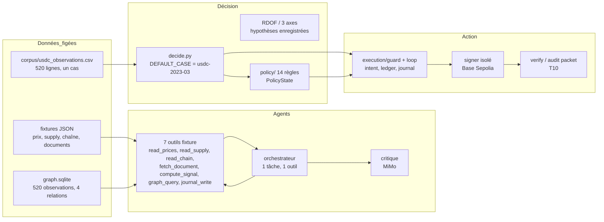
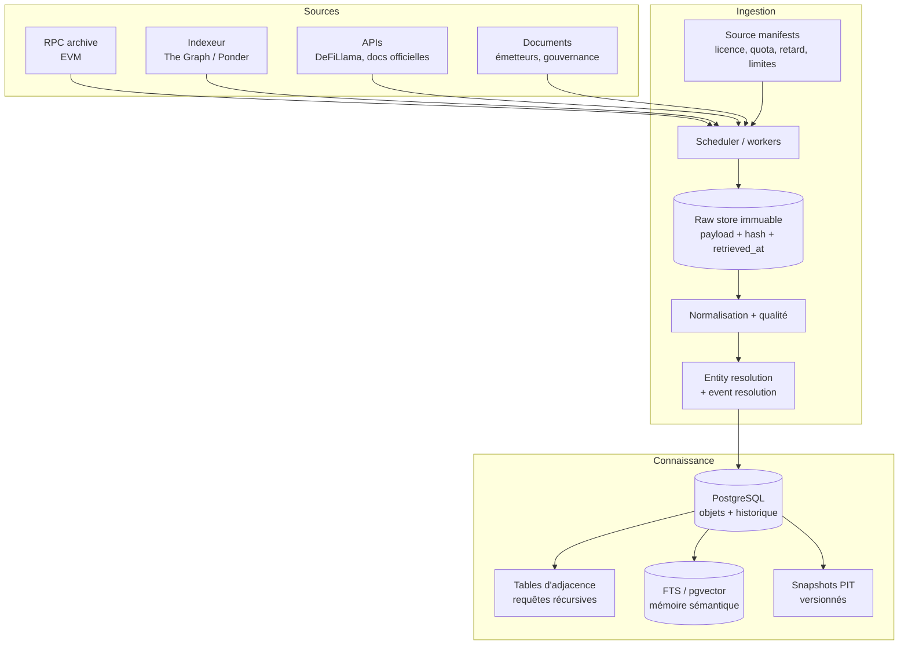
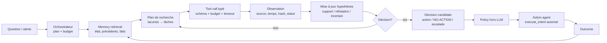

# ORVYREN — Réanalyse de direction

**Date** : 2026-10-17
**Objet** : confronter le système réellement construit aux documents d'idée d'origine, expliquer ce qui a été perdu, et proposer une architecture de vrai système — pas un prototype mono-cas.
**Périmètre** : `D:/orvyren_core` (code, tests, artefacts) + les documents d'idée fournis au début :
`concours/orvyren_v0_1_texte.txt` (V0.1), `orvyren_v02/ORVYREN_Selection_Cas_Usage_V0_1.txt`, `orvyren_v02/ORVYREN_Document_de_reference_V0_2.txt` (V0.2), `ORVYREN_DOC1_EXPLICATION_SIMPLE.md`.

**Règle de lecture** : ce document distingue explicitement **[FAIT MESURÉ]**, **[DOC D'ORIGINE]**, **[PATTERN EXTERNE]** et **[PROPOSITION]**. Il ne remplace pas une décision d'équipe ; il la prépare.

---

## 0. Verdict en dix lignes

1. **L'idée d'origine était un système de connaissance et de décision en boucle** : collecter des données réelles, construire un graphe factuel temporel, entretenir des hypothèses concurrentes, lancer des recherches ciblées avec des outils, décider ou s'abstenir, exécuter dans une enveloppe, puis mesurer le résultat. Le wallet était la **couche d'action**, pas l'identité du produit (V0.1 §1.1, §1.3).
2. **Ce qui a été construit est le noyau de confiance de cette boucle** : décision déterministe sur un cas gelé, politique de 14 règles, exécution signée, reçus, dossier d'audit, rejeu, vérificateur tiers. C'est réel, testé et rare.
3. **Mais la boucle elle-même n'existe pas** : pas de collecte récurrente, pas de graphe à l'échelle, pas de branches persistantes, pas de recherche outillée, pas de mémoire interrogeable, pas de produit.
4. **Le système est organisé autour d'un cas** (`usdc-2023-03`) au lieu d'un **utilisateur et d'un problème** : `src/orvyren/decide.py:51` fixe `DEFAULT_CASE` et `:190` refuse tout autre cas.
5. **Les agents ne sont pas des agents au sens outils + mémoire** : les sept outils de `src/orvyren/agents/tools.py` sont des **lookups sur fixtures**, sans réseau, et les fenêtres `from`/`to` sont ignorées (test `tests/test_agents_tools.py:155`). Le journal est une trace, pas une mémoire retrouvable.
6. **Le graphe est un jouet statistique** : 520 observations, **4 relations**, 4 claims, aucune table `entities`/`events`; 208 Ko de SQLite. Le document d'origine décrivait une ontologie, une temporalité et une provenance de bout en bout (V0.1 §7).
7. **La recherche adaptative est un enum déterministe** : RDOF choisit un prédicat parmi des faits déjà enregistrés; aucune tâche ne va chercher une source, un document, un log ou une API.
8. **La couche produit est absente** : 12 écrans statiques d'audit, pas d'espace de travail pour l'opérateur de trésorerie, pas de déclencheur récurrent, pas de parcours « alerte → enquête → preuve → décision → action → résultat ».
9. **La critique « un cas contrôlé » est donc juste partout** : un cas pour la décision, 4 relations pour le graphe, 2 fenêtres EVAL non assemblées (EVAL N=0), un seul parcours de démonstration.
10. **La bonne réponse n'est pas de tout jeter** : le noyau de confiance est l'actif à conserver. Il faut **reconstruire autour** — données live, graphe à l'échelle, agents outillés avec mémoire, produit — et cesser de présenter le noyau comme le système complet.

---

## 1. Méthode et preuves

### 1.1 Documents d'origine

| Document | Rôle | Références utilisées |
|---|---|---|
| `concours/orvyren_v0_1_texte.txt` | Document de référence V0.1, 13/10/2026 | §1.1 (cinq capacités), §3 (utilisateur/problème/JTBD), §6–7 (architecture, données, graphe), §8 (branches/recherche), §9 (agents/outils), §13 (expérimentation), §14 (MVP vertical) |
| `orvyren_v02/ORVYREN_Selection_Cas_Usage_V0_1.txt` | Sélection du cas pilote | §Résumé, §4 (problème/utilisateur/question), §5 (différenciation), §6 (mesures), §7 (validation) |
| `orvyren_v02/ORVYREN_Document_de_reference_V0_2.txt` | Référence V0.2, 13/10/2026 | §1 (définition), §3 (cas/utilisateur), §5–8 (architecture, données, branches, agents), §12 (expérimentation), §13 (MVP) |
| `ORVYREN_DOC1_EXPLICATION_SIMPLE.md` | Explication simple, 15/10/2026 | §2 (pour qui), §3 (boucle), §5 (preuves), §6 (ce que la v1 devait construire) |

### 1.2 Code et artefacts examinés

- `src/orvyren/decide.py`, `src/orvyren/decision/`, `src/orvyren/policy/`, `src/orvyren/execution/`
- `src/orvyren/agents/` (`loop.py`, `tools.py`, `journal.py`, `worker.py`, `prompts.py`, `contracts.py`)
- `src/orvyren/graph/`, `src/orvyren/branches/`, `src/orvyren/data/`
- `collect_corpus.py`, `run_agents.py`, `run_pipeline.py`, `run_evaluation.py`
- `src/orvyren/ui/screens.py`
- `evidence/quality_report.json`, `evidence/graph.sqlite`, `evidence/evaluation_eval/`, `evidence/agents_live/`
- `docs/RECHERCHE_AMELIORATION_ET_SCALING_2026-10-17.md` (mesures de la session précédente)

### 1.3 Sources externes (patterns éprouvés)

Voir §8 et §14. Les sources externes sont datées et citées; elles ne sont pas des preuves de supériorité d'ORVYREN, seulement des références de conception.

---

## 2. Ce que l'idée d'origine décrivait

### 2.1 Les cinq capacités, dans l'ordre

Le V0.1 définit ORVYREN comme une boucle continue de cinq capacités (lignes 67–72) :

1. **Collecter** des données et informations financières depuis des sources identifiées.
2. **Construire une représentation factuelle, historisée et sourcée** du monde.
3. **Conserver plusieurs interprétations prospectives** sous forme de branches spéculatives concurrentes.
4. **Sélectionner de nouvelles recherches** selon leur utilité attendue et **évaluer les prévisions** qu'elles produisent.
5. **Traduire les conclusions utiles en décisions financières** évaluées au niveau du portefeuille et, lorsque le périmètre le permet, en **actions on-chain** dans un cadre d'autorisation strict.

Le texte précise que l'idée centrale **n'est pas** de faire voter plusieurs LLM (lignes 73–78) : le système doit maintenir une **mémoire commune vérifiable**, laisser les agents explorer des hypothèses différentes, relier chaque conclusion aux preuves, et **mesurer après coup** si les recherches ont amélioré la connaissance, les prévisions ou les décisions.

### 2.2 L'utilisateur et le problème

Le V0.1 choisit comme cible provisoire l'**opérateur d'une petite trésorerie on-chain de DAO ou de protocole** (lignes 164–245). Son problème :

> « Un responsable de trésorerie on-chain dispose d'actifs et peut dépendre de plusieurs contrats ou protocoles, mais il doit relier des données dispersées, des évolutions de contexte et des scénarios incertains avant de décider d'une opération. ORVYREN l'aide à maintenir cette connaissance à jour, à examiner plusieurs explications concurrentes, à estimer les conséquences sur l'ensemble de la trésorerie et à exécuter uniquement les actions préautorisées qui répondent à sa politique. » (V0.1 §3.4)

Les jobs-to-be-done (lignes 252–261) sont explicites : comprendre l'état réel, savoir quels changements peuvent modifier la situation, conserver plusieurs interprétations, **rechercher les informations qui départagent**, évaluer les scénarios, choisir une décision dans la politique, faire exécuter une opération autorisée, puis **comparer le prévu au réalisé**.

La sélection de cas (13/10) retient le **depeg USDC/SVB de mars 2023** comme premier cas, avec une question de décision :

> « Les signaux observés autour de l'USDC justifient-ils une réaction de trésorerie, ou faut-il attendre une preuve supplémentaire ? »

et trois sorties : **NO-ACTION / données insuffisantes**, **continuer la recherche / attendre**, **action bornée préautorisée** (sélection §4.3). Le cas USDC est explicitement une **hypothèse de pilote**, pas une validation commerciale (sélection §4.2, §7).

### 2.3 Les agents, les outils et la mémoire

Le V0.1 §9 décrit des **rôles logiques** (planificateur, collecteur/analyste, extracteur/résolveur, explorateur de branche, critique, évaluateur, analyste de portefeuille, agent d'action), avec des **outils déterministes** (lignes 653–661) :

- `get_graph_snapshot`, `query_entities`, `trace_provenance`, `get_entity_history`
- `read_chain_state`, `get_transaction_receipt`, `query_logs`
- `get_protocol_metrics`
- `create_research_task`, `attach_evidence`, `update_hypothesis_status`
- `evaluate_scenario`, `compute_portfolio_exposure`, `compare_forecasts`
- `propose_intent`, `authorize_intent`, `execute_intent` (ce dernier réservé à la couche d'action)

Le contrat d'appel d'outil (lignes 662–667) exige un **schéma structuré**, une vérification de types et d'identité, une idempotence, une trace et un statut explicite. Le LLM ne doit **pas** pouvoir appeler un shell générique ou envoyer une calldata arbitraire. Le V0.2 §8.3 reprend : chaque outil a un nom, un schéma strict, des limites d'appel, un comportement en panne et un journal; les outils d'action ne sont pas exposés aux agents de recherche.

La mémoire n'est pas un simple journal : le V0.1 parle d'une **mémoire commune vérifiable** (lignes 73–78) et d'un **graphe factuel versionné** qui conserve les contradictions (lignes 296–310). Le V0.2 §7.1 définit une branche comme un objet contrôlé avec preuves favorables/défavorables, inconnues, critères de réfutation, état, probabilité éventuelle et **histoire de recherche**.

### 2.4 Données, graphe et recherche

Le V0.1 §6.1 décrit le flux :

**Sources → ingestion brute immuable → normalisation/qualité → résolution d'entités/événements → observations, claims, relations → graphe factuel versionné + index de recherche → branches → recherche → scénarios → décision → politique → exécution → outcome.**

Le V0.1 §7.1 définit les objets de première classe : Source, Observation, Entity, Event, Claim, Relation, Hypothesis, Branch, ResearchTask, Scenario/Forecast, PortfolioSnapshot, Decision/Intent, PolicyDecision, Transaction/Outcome, ExperimentRun. La temporalité est multi-horloge (événement, publication, observation, prise d'effet, validité, révision; §7.2). La provenance est une chaîne de bout en bout (§7.3). Le stockage recommandé est **PostgreSQL** avec tables d'adjacence, et une base graphe spécialisée seulement après benchmark (§7.5).

Le V0.1 §8 décrit les branches comme des interprétations persistantes du futur, attachées à une version du graphe, avec un cycle de vie (`CREATED`, `EXPLORING`, `TESTABLE`, `EVALUATING`, `ACTIVE`, `PAUSED`, `CLOSED`, `ARCHIVED`). La recherche adaptative est pilotée par la **valeur attendue de l'information**, l'importance décisionnelle, l'urgence, la faisabilité et le coût (§8.4–8.6). Le gestionnaire de ressources est distinct des agents; les agents ne peuvent pas augmenter leurs budgets.

### 2.5 Décision, action et évaluation

Le V0.1 §10–11 décrit la chaîne : scénarios → impact portefeuille → options admissibles → décision candidate/NO-ACTION → policy check hors LLM → intent → signature → transaction → receipt → outcome. Le wallet est **la couche d'action**, pas le produit. La politique est appliquée **en dehors du LLM**, les clés sont isolées, et l'agent ne peut pas élargir ses droits (V0.1 §11.2, §11.5).

Le protocole expérimental (V0.1 §13) compare **A0/A1/A2/A3/A4** : baseline simple, graphe, branches/recherche, multi-agent, écosystème complet. Il exige des métriques de provenance, de recherche, de branches, de prévisions, de décision et de sécurité, avec des ablations et un budget comparable. Le V0.2 réduit le premier slice à **A0 vs A2** et reporte A3/A4 (§12.1), mais conserve la exigence de comparaison.

### 2.6 Le MVP vertical

Le V0.1 §14.2 est le contrat le plus utile pour juger l'écart :

1. Utilisateur : opérateur d'une trésorerie on-chain limitée.
2. Domaine : un réseau EVM en écriture, un petit ensemble d'actifs/contrats, une ou deux sources DeFi en lecture.
3. Acquisition : RPC, indexeur/API, source manifest/version.
4. Graphe : actifs, wallet, contrat, protocole, indicateur/événement, preuve, relation, portefeuille **persistés et reliés**.
5. Branches : au moins **deux explications réellement concurrentes**, critères et tests, preuves attachées.
6. Recherche : l'agent identifie une lacune et **déclenche une tâche dont le résultat peut départager les branches**.
7. Évaluation financière : scénarios mappés sur un portefeuille de démonstration, contraintes, options.
8. Action : une opération unique autorisée (transfert ou swap testnet).
9. Exécution : politique indépendante, signature isolée, transaction, receipt, hash public.
10. Retour : transaction et résultat mettent à jour l'historique; une expérience est enregistrée.

---

## 3. Ce qui a été réellement construit

### 3.1 Vue « as-built »

**Ce qui manque visuellement** : un flux de données vivant, un graphe qui grandit, des branches persistantes, une mémoire interrogeable, des outils réseau, une boucle de recherche qui modifie les hypothèses, et un utilisateur dans la boucle.

### 3.2 Mesures du système actuel

| Indicateur | Valeur mesurée | Source |
|---|---:|---|
| Observations dans le graphe | **520** | `evidence/quality_report.json` (`corpus.rows`) |
| Relations | **4** | `evidence/graph.sqlite`, table `relations` |
| Claims | **4** | `evidence/graph.sqlite`, table `claims` |
| Entités / événements | **0 table `entities`, 0 table `events`** | `sqlite3` sur `evidence/graph.sqlite` |
| Taille SQLite | **208 Ko** | `ls -lh evidence/graph.sqlite` |
| Cas câblés | **1** (`usdc-2023-03`) | `src/orvyren/decide.py:51,190` |
| Outils agents | **7**, tous sur fixtures | `src/orvyren/agents/tools.py:10–17,75–84` |
| Fenêtres de recherche par run | **1 tâche, 1 outil** | `src/orvyren/agents/loop.py:8` |
| Rôles LLM effectifs | **2** (orchestrateur, critique) + canoniseur déclaré | `config/models.json`, `run_agents.py` |
| Écrans UI | **12**, statiques, audit | `src/orvyren/ui/screens.py` |
| Tests | **844 pytest / 846 unittest** (3 sautés) | session 17/10 |
| EVAL | **N = 0**, 2 fenêtres sautées | `evidence/evaluation_eval/evaluation_report.md` |
| Coût d'une session live | **0,0192 $**, 19 appels, ~295 s | `evidence/agents_live/` + rapport recherche |
| Graph EVAL windows | 2 déclarées, **séries non assemblées** | `src/orvyren/evaluation/windows.py:120,170–190` |

### 3.3 Ce qui est réellement bon (et à conserver)

Ce n'est pas rien — c'est même la partie la plus difficile à reconstruire :

- **Politique déterministe hors LLM** : 14 règles, codes de refus, `PolicyState`, fail-closed, plafonds par transaction et cumulés 24 h, pause/kill switch. C'est le cœur de la thèse sécurité (V0.1 §11).
- **Exécution bornée et vérifiable** : intent structuré, signer isolé, transaction testnet, receipt vérifié, journal chaîné, reçu et hash publics.
- **Preuve portable** : paquet d'audit T10, vérificateur hors ligne, 16 contrôles, mutations, rejeu; un tiers peut recalculer.
- **Provenance et PIT** : les artefacts gardent source, heure, hash; le rejeu refuse le futur.
- **Discipline de test** : 844 tests, tests de frontière, tests de non-régression, refus documentés.
- **Honnêteté des états** : `NO-ACTION`, `INCONCLUSIVE`, `NOT_REGISTERED`, `SKIPPED`, `OFFLINE_PASS`; les échecs ne sont pas maquillés.

**Conclusion** : le noyau de confiance est un actif. Le problème est qu'il a été présenté comme **le système**, alors qu'il n'en est que la **couche d'action**.

---

## 4. Les six écarts, avec preuves

### 4.1 Écart 1 — Un cas au lieu d'un persona et d'un problème

**Ce que le V0.1 demandait** : un utilisateur (opérateur de trésorerie on-chain), un problème (relier des signaux dispersés pour décider d'une opération bornée), des jobs-to-be-done, un résultat mesurable (V0.1 §3.3–3.6; sélection §4.2–4.3).

**Ce que le code fait** :
- `src/orvyren/decide.py:51` : `DEFAULT_CASE = "usdc-2023-03"`.
- `src/orvyren/decide.py:190–192` : tout autre cas est refusé (« case not wired in v1 »).
- La documentation et les artefacts sont nommés par cas (`decision_usdc-2023-03.json`, `dossier_usdc-2023-03.md`, écrans « Runs A/C/E »).
- L'UI est une **UI d'audit** (12 écrans de preuves), pas un **espace de travail utilisateur** : pas de tâche, pas d'alerte, pas de file d'enquêtes, pas de décision à prendre.

**Conséquence** : un jury voit un **prototype de recherche sur un épisode historique**, pas un produit qui aide un opérateur récurrent. Le cas est une **fixture de test**; un produit traite une **classe de situations** en continu.

**Sévérité** : bloquante pour le positionnement « produit » ; non bloquante pour une démo de noyau de confiance, à condition de ne pas prétendre autre chose.

### 4.2 Écart 2 — Les agents ne sont pas « LLM + outils + mémoire »

**Ce que le V0.1 demandait** : des rôles logiques avec des outils typés et une mémoire commune vérifiable (V0.1 §9.1–9.3), des branches avec preuves et histoire de recherche (V0.1 §8.1–8.3).

**Ce que le code fait** :
- `src/orvyren/agents/tools.py:10–17` : les sept outils v1 sont **offline and deterministic**, répondent depuis des fixtures injectées, **sans réseau, sans LLM, sans calcul**. `fetch_document` ne lit pas une URL : il lit un texte archivé.
- `src/orvyren/agents/tools.py:26–29` : les arguments `from`/`to` sont **ignorés** ; la fenêtre est déjà archivée. Le test `tests/test_agents_tools.py:155` le vérifie explicitement.
- `src/orvyren/agents/loop.py:8` : une seule tâche en vol, **un seul outil par tâche**, un appel de planification et une évaluation. C'est une boucle bornée, pas un agent qui explore.
- `src/orvyren/agents/journal.py` : journal append-only, avec poids de branche nul pour une proposition LLM; c'est une **trace**, pas un store de mémoire interrogeable.
- `config/models.json` : rôles orchestrateur/explorateur/critique/canoniseur, mais l'exécution réelle est orchestrateur + critique; pas de spécialistes outillés (collecteur, extracteur, explorateur de branches, évaluateur).
- Aucun `web_search`, aucun `http_get` de recherche, aucun `eth_getLogs` en direct dans les outils agents : `grep` sur `src/orvyren/agents` ne trouve que le transport LLM (`llm.py`), pas un outil de recherche.

**Conséquence** : l'agent **planifie et évalue** des réponses, mais il ne **cherche pas**. Les « recherches » sont des choix de prédicats RDOF sur des faits déjà présents; les outils sont des **lecteurs de fixtures**. La mémoire n'est pas utilisée pour retrouver une observation, une hypothèse ou un précédent.

**Sévérité** : bloquante pour la thèse « agents de recherche » ; c'est précisément le cœur de l'idée d'origine.

### 4.3 Écart 3 — Pas de pipeline de collecte / d'inférence ; la recherche n'est pas un outil

**Ce que le V0.1 demandait** : une acquisition de sources réelles, un pipeline d'ingestion, une normalisation, une résolution d'entités, un graphe mis à jour, et des agents capables de **déclencher de nouvelles recherches** (V0.1 §6.1, §8.4, §9.2; V0.2 §11.3).

**Ce que le code fait** :
- `collect_corpus.py` est un **collecteur one-shot** pour le cas USDC 2023 : il télécharge des prix DeFiLlama/Bitstamp/Binance, une série de supply, et écrit `corpus/`. Il n'y a pas de scheduler, pas de worker, pas de watermark incrémental, pas de source manifest générique, pas de reprise.
- `src/orvyren/data/` contient des adaptateurs utiles (`aave.py`, `chainlink.py`, `curve.py`, `rpc.py`), mais ils ne sont **pas câblés dans un pipeline récurrent**; ils servent à des reconstructions d'épisodes.
- Les agents lisent `fixtures/agents/...` : `read_prices` renvoie des lignes archivées; `read_chain` renvoie des observations archivées; `fetch_document` renvoie un document archivé.
- `ResearchTask` (contracts.py) a un champ `outil` unique; le planificateur choisit un des sept outils; il n'existe pas de tâche « va chercher sur le web », « interroge le RPC », « lis les logs de ce contrat », « compare trois sources ».
- La RDOF (`decision/rdof.py`) sélectionne un prédicat à évaluer parmi les faits enregistrés; c'est une **recherche d'information dans le dossier**, pas une **recherche dans le monde**.

**Conséquence** : le système ne peut pas découvrir un fait nouveau. Il ne peut que **rejouer** un fait déjà archivé. La valeur épistémique de la recherche (V0.1 §8.5) n'est pas mesurable.

**Sévérité** : bloquante pour un vrai agent; la démo peut fonctionner, mais elle est un **replay de fixtures**, pas une enquête.

### 4.4 Écart 4 — Le « cas contrôlé » contamine tout : branches, graphe, évaluation

**Ce que le V0.1 demandait** : des branches concurrentes persistantes, une recherche adaptative, un graphe qui grandit, une évaluation A0→A4 (V0.1 §8, §13).

**Ce que le code fait** :
- `branches/hypotheses.py` existe (registre d'hypothèses, critères), et `decide.py` enregistre les hypothèses du cas; mais il n'y a **pas de store de branches**, pas de cycle de vie `CREATED/EXPLORING/...`, pas d'API pour créer/attacher une preuve, pas de branche concurrente réellement maintenue entre deux runs.
- Les 520 observations et 4 relations sont **un seul corpus**, calibré pour un cas; les requêtes Q1–Q8 sont des scans Python en mémoire (le rapport recherche le dit : 520 obs, 4 relations, 213 Ko).
- L'EVAL est bloquée par des **séries non assemblées** : `eval-rseth-2026-04` et `eval-usd0pp-2025-01` sont toutes deux `SKIPPED`; le premier passage EVAL a produit **N = 0** (`evidence/evaluation_eval/evaluation_report.md`). Le lock `eval_run.lock` est brûlé.
- Les tests sont des tests de **fixtures** : ils prouvent la reproductibilité du cas, pas la capacité à traiter des données nouvelles.

**Conséquence** : chaque brique est optimisée pour **un test contrôlé**, pas pour **un système ouvert**. C'est une différence de nature, pas de degré.

**Sévérité** : bloquante pour la crédibilité « système » ; le jury peut le voir en demandant « et avec un autre protocole ? ».

### 4.5 Écart 5 — Le graphe est ridiculement petit

**Ce que le V0.1 demandait** : une ontologie (Source, Observation, Entity, Event, Claim, Relation, Hypothesis, Branch...), une temporalité multi-horloge, une provenance de bout en bout, un stockage PostgreSQL, une capacité multi-protocoles (V0.1 §7; V0.2 §6).

**Ce que le code fait** :
- `evidence/graph.sqlite` : **520 observations, 4 relations, 4 claims**, pas de table `entities` ni `events`; 208 Ko.
- Le rapport de recherche qualifie le graphe de « minuscule » et les requêtes de « scans Python en mémoire » (`docs/RECHERCHE_AMELIORATION_ET_SCALING_2026-10-17.md`, §0, §2).
- L'ontologie `graph/catalog.py` contient 34 types de relations, mais **4 relations** sont instanciées; c'est un catalogue, pas un graphe.
- Aucune ingestion d'événements on-chain à grande échelle (logs, upgrades, gouvernance, positions) n'est branchée.

**Conséquence** : le graphe ne peut pas répondre à une question de propagation, de concentration ou de dépendance à l'échelle d'une trésorerie réelle. Il illustre la sémantique, il ne la prouve pas.

**Sévérité** : bloquante pour l'ambition « knowledge system » ; c'est le point le plus visible pour un jury technique.

### 4.6 Écart 6 — La construction multi-agent n'est pas maîtrisée

**Ce que le V0.1 demandait** : des rôles logiques, des outils typés, une mémoire partagée, un gestionnaire de ressources, une comparaison baseline vs multi-agent (V0.1 §9, §13).

**Ce que le code fait** :
- Deux rôles effectifs (orchestrateur + critique) avec des prompts et un magasin d'appels enregistrés; le « multi-agent » est un **échange de deux messages** dans un pipeline scripté.
- Pas de **planificateur d'outils** général : `ResearchTask` = un outil, une clé de fixture.
- Pas de **mémoire de travail** (état de l'enquête) ni de **mémoire longue** (faits, précédents, leçons) : le journal est un log d'audit.
- Pas de **reprise/checkpoint** d'une enquête interrompue; pas de **human-in-the-loop** au niveau de l'outil; pas de **budget par outil/source** au-delà des compteurs.
- Pas d'**évaluation agent** : succès de tâche, précision des appels d'outils, couverture des preuves, valeur de recherche, coût par preuve utile. Les tests actuels sont des tests de contrats et de déterminisme.

**Conséquence** : on a un **orchestrateur de prompts** et une **politique d'exécution**, pas un **runtime d'agents**. Le reproche est juste : la partie agentique est la moins maîtrisée du projet.

**Sévérité** : bloquante pour le thème F si le jury attend un agent autonome; le noyau de confiance reste défendable comme **safety layer**, mais pas comme **agent system**.

---

## 5. Pourquoi on en est arrivé là

Ce n'est pas un manque d'intelligence ou de travail. C'est un **biais d'optimisation** :

1. **La deadline a poussé vers ce qui est testable offline.** Un cas gelé, des fixtures, des tests déterministes : on peut prouver. Un pipeline live, un graphe à l'échelle, une recherche web : on ne peut pas garantir le déterminisme, et ça casse les tests.
2. **Le gel et la vérification ont pris le dessus sur le produit.** Le projet a accumulé des preuves (dossier, paquet T10, rejeu, 844 tests) mais a rarement demandé : « quel utilisateur, quel parcours, quelle valeur récurrente ? ».
3. **Le cas USDC est devenu le produit.** Il était une **hypothèse de pilote** (sélection §4.2, V0.2 §3.2). Il est devenu l'identifiant du système : `DEFAULT_CASE`, noms de fichiers, écrans. Le cas a mangé la classe de problèmes.
4. **Les agents ont été réduits à des prompts + fixtures pour rester déterministes.** C'était une bonne intention de test, mais elle a supprimé la capacité qui définissait l'idée : **chercher**.
5. **Le graphe a été réduit à ce que le cas USDC permettait.** 520 observations suffisent pour une démonstration, pas pour un système de connaissance.
6. **L'UI a été construite pour le jury, pas pour l'utilisateur.** 12 écrans d'audit, alors que le produit demandait un **espace de travail d'enquête**.
7. **Le multi-agent a été abordé comme une juxtaposition de prompts, pas comme un runtime.** On a deux rôles et un magasin d'appels; on n'a pas de tools callables, de mémoire, de reprise, d'évaluation d'agent.

**Ce n'est pas irréversible.** Le noyau de confiance est justement ce qui manque à beaucoup d'équipes; il faut maintenant construire **autour**, pas à la place.

---

## 6. Ce qu'il ne faut pas jeter

| Actif | Pourquoi le garder | Risque si on le jette |
|---|---|---|
| `policy/` 14 règles + `PolicyState` | Le LLM ne peut pas autoriser; les refus sont codés, testés, fail-closed | Perte de la thèse sécurité; retour à un prompt |
| `execution/` intent + signer + receipt | Exécution bornée et vérifiable, testnet, clés isolées | Perte de la preuve on-chain |
| `verify/` T10 + paquet d'audit | Preuve portable qu'un tiers peut recalculer | Perte du différenciateur |
| `replay/` PIT + journaux chaînés | Reproductibilité, refus du futur | Perte de la crédibilité |
| `evaluation/` gel G1–G6 | Discipline anti-fish, pré-enregistrement | Perte de la rigueur |
| `decision/` RDOF + 3 axes | Mécanisme original, explicable | Perte de l'originalité |
| Tests de frontière/injection | Sécurité réelle, pas narrative | Perte de la qualité |

**Principe** : le noyau de confiance devient la **couche d'action** d'un système agentique plus large. Il n'est plus le produit; il est le **différenciateur de sûreté**.

---

## 7. Architecture cible (v2)

### 7.1 Produit et persona

**Persona** : opérateur de trésorerie on-chain d'une DAO/protocole (ou analyste de risque DeFi), responsable d'une exposition en stablecoins/collatéraux, avec une politique écrite et un wallet borné.

**Job récurrent** : « Chaque jour / à chaque alerte, identifier ce qui menace la trésorerie, comprendre le mécanisme, rassembler les preuves, décider d'agir ou de s'abstenir, et pouvoir justifier la décision à un tiers. »

**Promesse produit** : un **espace de travail d'enquête** qui transforme un signal dispersé en **dossier de décision** traçable, avec une action bornée optionnelle.

```mermaid
flowchart LR
    A[Alerte / question<br/>depeg, saturation, gouvernance] --> B[Espace d'enquête<br/>état du portefeuille + exposition]
    B --> C[Graphe temporel<br/>faits, relations, contradictions]
    C --> D[Hypothèses concurrentes<br/>H1/H2/H3 + critères de réfutation]
    D --> E[Recherche outillée<br/>RPC, logs, prix, documents, web]
    E --> F[Preuves attachées<br/>sources, temps, hash]
    F --> G[Décision candidate<br/>action / attente / NO-ACTION / escalade]
    G --> H[Politique hors LLM<br/>ALLOW / DENY / REQUIRE_APPROVAL]
    H --> I[Exécution bornée<br/>signer isolé, receipt]
    I --> J[Outcome + calibration<br/>prévu vs réalisé]
    J --> C
```

### 7.2 Plan de données

**Règles** :
- raw immuable, hash, `retrieved_at`, `event_time`, `published_at`, `finality`;
- idempotence + watermark par source;
- aucune observation inventée : `UNKNOWN`/`UNAVAILABLE` explicites;
- PIT strict : un snapshot ne contient que ce qui était connu à `as_of`;
- source manifest pour chaque connecteur.

### 7.3 Plan de connaissance et de graphe

**Objets** : Source, Observation, Entity, Event, Claim, Relation, Hypothesis, Branch, ResearchTask, Evidence, Scenario, Forecast, PortfolioSnapshot, Decision, PolicyDecision, Execution, Outcome, ExperimentRun.

**Relations typées** : dépendance, exposition, contrôle, collateral, oracle, pool, bridge, governance, upgrade, incident, contradicition, support/refutation.

**Temporalité** : `valid_from`, `valid_to`, `observed_at`, `published_at`, `block_number`, `block_hash`, `finality`, `revision_of`.

**Échelle cible** :
- premier slice : **10⁴–10⁵ événements** (un protocole, 30–90 jours, une chaîne);
- v2 : **10⁶+ événements**, 3–10 protocoles, 1–3 chaînes;
- requêtes : exposition consolidée, chemins de dépendance, contradictions, concentration, PIT, provenance, permissions.

**Stockage** : PostgreSQL d'abord (tables + index + requêtes récursives), pas de base graphe spécialisée avant benchmark (V0.1 §7.5). Si un graphe dédié devient nécessaire, il est un **index dérivé**, pas la source de vérité.

**Mémoire** :
- **working memory** : état de l'enquête (question, hypothèses, prochaines actions);
- **episodic** : runs, décisions, outcomes, erreurs, coûts;
- **semantic** : claims/relations, embeddings/FTS, entités;
- **procedural** : playbooks, requêtes, outils, skills (inspiration Voyager);
- retrieval PIT-safe; résumé + liens vers les preuves; jamais de “mémoire” inventée.

### 7.4 Plan agentique

**Rôles** (à ajouter progressivement, pas tous dès le premier jour) :
- **Orchestrateur/planificateur** : décompose, choisit les tâches, gère le budget.
- **Chercheur** : exécute les outils de lecture (RPC, indexeur, prix, documents, web).
- **Extracteur/résolveur** : transforme les observations en claims/relations, avec validation.
- **Explorateur de branches** : maintient les hypothèses concurrentes et leurs critères.
- **Critique adversarial** : cherche contre-preuves, erreurs d'unité, sources corrélées.
- **Évaluateur** : compare aux critères préenregistrés, produit INCONCLUSIVE si nécessaire.
- **Analyste portefeuille** : scénarios → exposition → options.
- **Agent d'action** : seulement `propose_intent` / `execute_intent` autorisé; pas d'accès aux clés.

**Ce qu'il faut copier des patterns éprouvés** :
- Un agent = **LLM + tools + memory + control loop**, pas un prompt qui répond (Anthropic, 2024).
- Commencer par des **workflows simples** et un seul agent; ajouter des rôles seulement si une ablation montre un gain (Anthropic, 2024; 12-Factor Agents).
- **Outils = sorties structurées** avec schéma, validation, idempotence, timeout, erreurs; pas de shell/calldata libre (12-Factor Factor 1/4; OpenAI guide).
- **Mémoire courte + longue** : checkpoints d'état + store interrogeable (LangGraph; MemGPT; Zep/Graphiti).
- **Boucle ReAct** : raisonner → agir → observer → mettre à jour; les observations doivent changer l'état (ReAct, 2022).
- **Skills library** : capitaliser les procédures validées (Voyager, 2023).
- **Orchestration manager** : agents spécialisés appelés comme outils; handoffs seulement si nécessaire (OpenAI guide; AutoGen, 2023).
- **Évaluation** : succès de tâche, précision des outils, couverture des preuves, coût/latence, sécurité; pas seulement un score agrégé.
- **Durable execution** : reprise, pause, human-in-the-loop, traces (LangGraph; 12-Factor Factor 6/8).

### 7.5 Plan décision/action (conservé)

Le noyau existant reste :

- `decision/` : RDOF, 3 axes, abstention, catalogues.
- `policy/` : 14 règles, `PolicyState`, fail-closed.
- `execution/` : intent, ledger 24 h, signer, receipt.
- `verify/` + `audit/` : dossier, paquet, T10.
- `replay/` : PIT, journaux chaînés.

La nouveauté est **en amont** : le dossier de décision est alimenté par un graphe et des recherches réelles, pas par des fixtures.

### 7.6 Plan d'évaluation

| Niveau | Mesures | Baseline |
|---|---|---|
| Agent | succès de tâche, outils corrects, preuves nouvelles, coût/latence, reprises | agent sans mémoire / agent sans outils |
| Recherche | faits nouveaux validés, discrimination d'hypothèses, coût par preuve utile | RDOF seule, recherche fixe |
| Graphe | complétude, provenance, PIT, contradictions | CSV + dashboard |
| Décision | qualité vs règle fixe, abstentions correctes, faux signaux | A0 |
| Sécurité | 0 action hors politique, refus corrects, receipt | tests adversariaux |
| Produit | temps jusqu'à la preuve, temps de décision, confiance de l'opérateur | workflow manuel |

**Règle** : N < 100 ⇒ « non conclusionnel »; pas de score unique; R⁻/R⁺ séparés; ablation à budget égal.

### 7.7 Interface produit

Un **espace d'enquête** unique, pas 12 écrans :

- **En-tête** : question, portefeuille, exposition, statut live/replay, âge des données.
- **Colonne gauche** : alertes, hypothèses, branches, critères de réfutation.
- **Colonne centrale** : graphe temporel interactif, preuves, sources, contradictions.
- **Colonne droite** : recherche en cours (outils, coûts, observations), décision candidate, policy, action, receipt.
- **Pied** : trace complète, hash, replay, limites.

L'UI doit montrer **le travail de l'agent** (outils, observations, mémoire) et **les preuves**, pas seulement le résultat.

---

## 8. Patterns éprouvés à réutiliser

| Pattern | Source | Ce qu'on copie | Ce qu'on ne copie pas |
|---|---|---|---|
| Workflows vs agents | Anthropic, *Building effective agents*, 2024-12-19 | Commencer simple; agent = LLM + outils + boucle; documenter les outils | Framework lourd dès le départ |
| Tools/guardrails/orchestration | OpenAI, *A practical guide to building agents*, 2025 | Outils typés, instructions, guardrails, escalade humaine | Multi-agent comme but |
| ReAct | Yao et al., arXiv:2210.03629, 2022 | Raisonnement + action + observation dans une boucle | Chaîne de pensée sans environnement |
| 12-Factor Agents | HumanLayer, GitHub | Own prompts/context, tools = structured outputs, execution state, control flow, small agents, stateless reducer | “Bag of tools + loop” sans ingénierie |
| Mémoire courte/longue | LangGraph persistence docs | Checkpoints d'état + store long terme | Mémoire = simple historique de chat |
| Mémoire hiérarchique | MemGPT, arXiv:2310.08560, 2023 | Contexte virtuel, déplacement entre mémoire principale/secondaire | Complexité si le store est petit |
| Graphe temporel de mémoire | Zep/Graphiti, arXiv:2501.13956, 2025 | Graphe temporel, relations historisées, retrieval | Base graphe avant benchmark |
| Skills library | Voyager, arXiv:2305.16291, 2023 | Compétences exécutables réutilisables | Curriculum automatique sans environnement |
| Multi-agent conversation | AutoGen, arXiv:2308.08155, 2023 | Agents spécialisés, orchestration par conversation | Consensus/vote comme vérité |
| Indexation EVM | The Graph, Ponder | Indexer les events, requêtes, reorg handling | Indexeur maison exhaustif |
| Données de marché | DeFiLlama API | Prix/séries/TVL, manifeste et limites | Utiliser une API agrégée comme preuve on-chain |
| Orchestration data | Dagster/Prefect/Airflow | Jobs idempotents, watermarks, reprises, observabilité | Pipeline one-shot |

**Conclusion pattern** : l'architecture cible n'est pas “plus de LLM”; c'est **plus d'ingénierie autour du LLM** (outils, état, mémoire, données, évaluation, reprise). C'est exactement ce qui manque aujourd'hui.

---

## 9. Matrice des écarts et priorités

| # | Écart | Preuve | Impact | Effort (h-agent) | Priorité |
|---|---|---|---|---|---|
| G1 | Persona/produit absent | `decide.py:51,190`; UI audit | Jury ne voit pas un produit | 6–10 | P0 |
| G2 | Ingestion live absente | `collect_corpus.py` one-shot; pas de workers | Pas de données nouvelles | 16–24 | P0 |
| G3 | Graphe 520 obs / 4 relations | `graph.sqlite`; `quality_report.json` | Pas de système de connaissance | 16–24 | P0 |
| G4 | Outils fixtures, recherche absente | `agents/tools.py:10–17,75–84`; test `:155` | Pas d'agent | 20–30 | P0 |
| G5 | Mémoire absente | `agents/journal.py`; pas de store/retrieval | Pas d'apprentissage inter-runs | 10–16 | P1 |
| G6 | Branches non persistantes | `branches/hypotheses.py`; pas de store/API | Pas d'hypothèses concurrentes | 12–18 | P1 |
| G7 | EVAL N=0 | `evidence/evaluation_eval` | Pas de résultats EVAL | 10–16 | P1 |
| G8 | UI audit statique | `ui/screens.py` | Pas d'espace de travail | 12–18 | P1 |
| G9 | Ops/scale | SQLite, mono-process | Pas de service | 20–30 | P2 |
| G10 | Évaluation agent | pas de métriques outils/tâches | Pas de preuve multi-agent | 8–12 | P1 |

**Lecture** : G1–G4 sont les fondations ; sans elles, le reste est du polish. G5–G8 rendent le système crédible ; G9–G10 sont des chantiers de scale.

---

## 10. Plan 72 h — slice verticale crédible (si on choisit de reconstruire maintenant)

**Objectif** : prouver que le système peut **enquêter sur un cas réel avec des outils**, pas seulement rejouer un cas.

**Périmètre serré** :
- **Un protocole** : Aave v3 sur Base (ou un marché au choix) + prix USDC/ETH via DeFiLlama.
- **Une fenêtre** : 30–90 jours; 10⁴–10⁵ événements on-chain (logs) + prix horaires.
- **Un persona** : opérateur de trésorerie; une question : « Cette anomalie de collatéral/stablecoin est-elle locale ou systémique, et que faire ? »
- **Un workflow** : alerte → enquête → 3 hypothèses → 2–3 outils → décision/abstention → policy → action/refus → receipt → trace.
- **Un écran** : espace d'enquête, pas 12 écrans.

**Livrables** :
1. **Ingestion** : `src/orvyren/ingest/` + `sources/` + `workers/`; source manifest; raw store; normalisation; graph writer; watermark; reprise. Preuve : 10⁴+ événements, `graph.sqlite`/Postgres, `quality_report`.
2. **Outils agents live** : `graph_query`, `read_chain_logs`, `price_history`, `web_search`, `fetch_document`; schémas, timeout, budget, trace. Preuve : une tâche réelle qui va chercher une donnée absente des fixtures.
3. **Mémoire** : store `memory` (episodic + semantic) avec retrieval; checkpoint d'état d'enquête. Preuve : deux runs, le second retrouve un précédent.
4. **Boucle agent** : plan → tool → observation → hypothèse → décision; 2–3 itérations; coût/latence mesurés.
5. **UI** : un écran d'enquête avec graphe/preuves/outils/décision.
6. **Preuve** : décision + policy + exécution existante; un refus et un ALLOW; receipt testnet.
7. **Évaluation** : A0 vs A2 sur la fenêtre; N petit, verdict non conclusionnel; trace.

**Non-goals** : multi-chaîne, multi-protocole exhaustif, multi-agent complet, base graphe dédiée, EVAL N≥100, apprentissage, KMS.

**Calendrier réaliste** :
- J1 matin : persona, question, source manifest, schéma graphe.
- J1 après-midi : ingestion + normalisation + 10⁴ events.
- J2 matin : outils live + mémoire + boucle agent.
- J2 après-midi : UI enquête + décision/policy.
- J3 matin : preuves, tests, scénario de démo.
- J3 après-midi : répétition, doc, soumission.

**Risque** : 72 h est très court. Si l'équipe ne peut pas y consacrer 40–60 h-agent, il faut choisir l'option “soumission honnête” ci-dessous, pas promettre un système qui n'existe pas.

---

## 11. Plan 2–4 semaines — vrai système

| Vague | Chantier | Contenu | Effort |
|---|---|---|---|
| S1 | Data plane | Postgres, 3–5 sources, scheduler, raw store, normalisation, PIT, manifests | 8–12 j |
| S1 | Graph | ontologie, entity/event resolution, relations, requêtes, snapshots | 8–12 j |
| S2 | Agent runtime | outils live, mémoire, ReAct, checkpoints, budgets, traces | 10–15 j |
| S2 | Branches | store, cycle de vie, preuves, recherche adaptative | 6–10 j |
| S3 | Product UI | espace d'enquête, files, statut live/replay, preuves | 8–12 j |
| S3 | Evaluation | A0–A2, N≥100, agent metrics, ablations, coûts | 8–12 j |
| S4 | Ops/security | workers, observabilité, KMS, rate limits, runbooks | 8–12 j |

**Total** : ~60–85 j-h, 4–6 semaines avec 2–3 agents; 3 semaines avec 4–5 agents. Ne pas promettre moins.

---

## 12. Décision recommandée

### Option A — Soumettre le noyau de confiance, honnêtement
**Contenu** : le policy/execution/audit actuel; un cas; une démo de refus/ALLOW; un dossier T10.
**Positionnement** : « couche de sûreté et de preuve pour agents wallet », pas « système multi-agent complet ».
**Avantage** : finissable, honnête, réel.
**Risque** : le jury peut le trouver trop étroit pour le thème F; peu d'interaction.

### Option B — Slice verticale v2 en 72 h (recommandée si l'équipe peut)
**Contenu** : un protocole live, un graphe 10⁴+, des outils réels, une mémoire, une boucle d'enquête, un écran, la preuve existante.
**Positionnement** : « agent de risque de trésorerie qui enquête et agit dans une enveloppe ».
**Avantage** : répond aux six critiques; montre un vrai système, pas un cas.
**Risque** : scope très serré; données live imprévisibles; nécessite de couper tout le reste.

### Option C — Reconstruire le système complet avant le 20/10
**Verdict** : **non réaliste**. Un vrai système demande 60–85 j-h; le faire en 72 h produirait un patchwork non testé. Ne pas choisir.

**Recommandation** : **Option B** si l'équipe peut mobiliser 2–3 agents pendant 72 h et accepter de réduire la démo à un protocole/une question. Sinon **Option A**, avec un discours lucide et le présent document comme roadmap.

**Dans les deux cas** : ne plus présenter le cas USDC comme le produit; le cas est une **fixture de régression**. Le produit est le **workflow** qui traite une classe de situations.

---

## 13. Actions immédiates (ordre)

1. **Réécrire le pitch** autour du persona et du job (pas du cas) : « Pour l'opérateur de trésorerie on-chain, ORVYREN enquête sur une anomalie, rassemble les preuves, décide ou s'abstient, et n'exécute que dans l'enveloppe. »
2. **Choisir un protocole et une question** : Aave v3 Base, 90 jours, question « local vs systémique ».
3. **Construire l'ingestion** : source manifest, raw store, normalisation, graph writer; mesurer 10⁴ événements.
4. **Brancher les outils live** derrière le contrat `ToolResult` existant : `graph_query`, `chain_logs`, `price_history`, `web_search`, `fetch_document`.
5. **Ajouter la mémoire** : `memory` store + retrieval + état d'enquête.
6. **Remplacer le plan de recherche** par une boucle ReAct/plan-execute avec budget et traces.
7. **Construire l'écran d'enquête** (un seul) et le scénario de démo.
8. **Évaluer A0 vs A2** sur la fenêtre; publier N, coûts, limites, verdict non conclusionnel si N < 100.
9. **Mettre à jour le dossier** : ce qui est live, ce qui est replay, ce qui est fixture, ce qui n'est pas revendiqué.
10. **Ne pas ajouter** de troisième agent, de multi-chaîne ou de base graphe avant que les étapes 1–8 soient vertes.

---

## 14. Sources

### 14.1 Documents internes (références de ligne)

- `concours/orvyren_v0_1_texte.txt` : §1.1 (67–78), §3 (164–267), §6–7 (361–527), §8 (539–615), §9 (617–673), §13 (885–965), §14 (982–1036).
- `orvyren_v02/ORVYREN_Selection_Cas_Usage_V0_1.txt` : résumé (9–12), §4 (36–52), §5 (51–53), §6 (54–60), §7 (61–74).
- `orvyren_v02/ORVYREN_Document_de_reference_V0_2.txt` : §1 (30–43), §3 (55–79), §5–8 (95–139), §12–13 (187–214), §12.1 (334–339).
- `ORVYREN_DOC1_EXPLICATION_SIMPLE.md` : §2 (17–22), §3 (23–56), §4 (58–64), §6 (77–84).
- `docs/RECHERCHE_AMELIORATION_ET_SCALING_2026-10-17.md` : mesures 520 obs/4 relations, 155 ms p50/192 ms p95, 294,9 s live, 0,0244 $/décision, 82 s de tests.
- Code : `src/orvyren/decide.py:51,190`; `src/orvyren/agents/tools.py:10–17,26–29,75–84`; `tests/test_agents_tools.py:155`; `src/orvyren/agents/loop.py:8`; `src/orvyren/agents/journal.py`; `collect_corpus.py:1–38`; `src/orvyren/ui/screens.py`; `config/models.json`; `evidence/quality_report.json`; `evidence/graph.sqlite`; `evidence/evaluation_eval/evaluation_report.md`.

### 14.2 Sources externes (consultées le 2026-10-17)

- Anthropic, *Building effective agents*, 2024-12-19 — https://www.anthropic.com/engineering/building-effective-agents — workflows vs agents; agent = LLM + tools + environmental feedback; conception des outils.
- OpenAI, *A practical guide to building agents*, 2025 — https://openai.com/business/guides-and-resources/a-practical-guide-to-building-ai-agents — outils, instructions, guardrails, orchestration, intervention humaine.
- Yao et al., *ReAct: Synergizing Reasoning and Acting in Language Models*, arXiv:2210.03629, 2022 — https://arxiv.org/abs/2210.03629 — raisonnement/action/observation.
- HumanLayer, *12-Factor Agents* — https://github.com/humanlayer/12-factor-agents — prompts/context, tools as structured outputs, execution state, control flow, small agents, stateless reducer.
- LangChain, *LangGraph persistence* — https://docs.langchain.com/oss/python/langgraph/persistence — checkpoints (court terme) + stores (long terme).
- Packer et al., *MemGPT: Towards LLMs as Operating Systems*, arXiv:2310.08560, 2023 — https://arxiv.org/abs/2310.08560 — mémoire hiérarchique.
- Rasmussen et al., *Zep: A Temporal Knowledge Graph Architecture for Agent Memory*, arXiv:2501.13956, 2025 — https://arxiv.org/abs/2501.13956 — graphe temporel de mémoire.
- Wang et al., *Voyager: An Open-Ended Embodied Agent with Large Language Models*, arXiv:2305.16291, 2023 — https://arxiv.org/abs/2305.16291 — bibliothèque de compétences.
- Wu et al., *AutoGen: Enabling Next-Gen LLM Applications via Multi-Agent Conversation Framework*, arXiv:2308.08155, 2023 — https://arxiv.org/abs/2308.08155 — agents conversationnels spécialisés.
- The Graph, *Querying subgraphs* — https://thegraph.com/docs/en/subgraphs/querying/introduction/ — indexation EVM.
- Ponder, *Get started* — https://ponder.sh/docs/get-started — indexeur EVM open-source.
- DeFiLlama, *API documentation* — https://api-docs.defillama.com/ — prix, séries, TVL.
- Ethereum.org, *JSON-RPC API* — https://ethereum.org/developers/docs/apis/json-rpc/ — lecture transactions/receipts/logs.

**Limites** : les sources externes décrivent des patterns; elles ne prouvent pas que ORVYREN les implémente. Les mesures internes sont datées du 17/10/2026 et reproductibles par les commandes du dépôt. Les chiffres EVAL N=0 sont un état, pas une performance.
