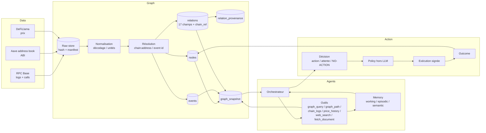

# Synthèse — architecture graph-first v2 et plan 72 h

**Statut** : `DRAFT` — synthèse des travaux graphe Hermes ; à fusionner avec les rapports des autres IA quand ils arrivent.
**Auteur** : Hermes.
**Date** : 2026-10-17.
**Chantier** : `60_synthesis`.
**Rapports liés** :
- `10_graph/10_graph__audit-34-relations__hermes__2026-10-17.md`
- `10_graph/10_graph__schema-cible__hermes__2026-10-17.md`
- `00_brief/REANALYSE_ORVYREN_2026-10-17.md`
**Sources** : `B2_GRAPHE_ETUDE.md`, `MIMIR_Technical_Design.md` §10–11, `Project_2_DFKG_Research_State_0_a11y.docx` §7–18, code `src/orvyren/graph/`, `evidence/graph.sqlite`, benchmark `_bench/bench_results_guarded.json`.

---

## 0. Décision

**ORVYREN v2 est un système graph-first.** Le graphe n'est pas un module de stockage : c'est le modèle du monde qui rend les décisions possibles, et la seule partie du projet qui peut être réellement différenciante.

Les agents outillés, les recherches, les exécutions bornées et la sécurité sont **nécessaires**, mais ce sont des capacités attendues. Le graphe est ce qu'un jury n'aura pas vu ailleurs : une représentation **dynamique, temporelle, provenance-aware et épistémiquement explicite** du monde on-chain, reliée à une décision et à une action.

**Conséquence** : la démo 72 h doit montrer le graphe **en premier**, pas 12 écrans d'audit. L'audit et la policy restent, mais en couche de confiance.

---

## 1. Ce qui change par rapport au système actuel

| Axe | Aujourd'hui | Cible v2 |
|---|---|---|
| Cas | `usdc-2023-03`, un cas | Aave v3 Base, une classe de situations |
| Graphe | 520 observations, 4 claims, 4 `SUPPORTS`, 0 structure | 10k+ événements, 2k+ nœuds, 10k+ relations, 16 kinds |
| Record relation | 17 champs spécifiés, non persistés | 17 champs + champs on-chain en SQL |
| PIT | `revision`/`inserted_at` partiels | bitemporel complet : monde ∩ connaissance, block-native |
| Collecte | one-shot `collect_corpus.py` | pipeline logs/calls + watermark + reprise |
| Agents | 7 outils fixtures, 1 tâche/1 outil | outils live, `graph_query`/`graph_path`, boucle multi-étapes |
| Mémoire | journal append-only | à ajouter (working/episodic/semantic) |
| UI | 12 écrans statiques | un espace d'enquête |
| EVAL | N=0 | mesure honnête de la démo, pas de revendication EVAL |

---

## 2. Architecture cible



**Lecture** : le graphe est à la fois **la source** des hypothèses et **l'outil** que l'agent interroge. La policy et l'exécution restent hors du LLM.

---

## 3. Le slice graphe 72 h

### 3.1 Périmètre

- **Chaîne** : Base mainnet, `chain_id = 8453`.
- **Protocole** : Aave v3 (Pool, Oracle, aTokens, debt tokens).
- **Fenêtre** : 30 jours d'abord ; 90 jours si les quotas RPC le permettent.
- **Volume cible** : 10 000–50 000 événements décodés, 2 000+ nœuds, 10 000+ relations.
- **Trésorerie** : une adresse de démonstration avec des positions Aave ; pas de clé privée réelle, pas de fonds réels.
- **Relations** : 16 kinds (voir audit §7.1) :
  `DEPLOYED_ON`, `ISSUED_BY`, `TARGETS_PEG`, `HOLDS`, `OWES`, `DEPOSITED_IN`, `COLLATERALIZES`, `PRICED_BY`, `CONSTRAINS`, `MEMBER_OF`, `ALLOWS`, `ADMINISTERED_BY`, `OBSERVED_FROM`, `DERIVED_FROM`, `SUPPORTS`, `CONTRADICTS`.

### 3.2 Requêtes de décision

Le graphe doit répondre à **cinq questions** dans la démo :

1. **Q1 — Exposition consolidée** : quels actifs, quels marchés, directs + indirects ?
2. **Q4 — PIT** : que savait-on au bloc B / à l'instant T ?
3. **Q6 — Provenance** : de la décision à la source, avec hashes.
4. **Q7 — Concentration** : quelle dette est adossée à quel actif, quel poids, quel HHI ?
5. **Q8 — Permissions** : qui peut déplacer quoi, as-of bloc B ?

Q2 (dépendances), Q3 (contradictions), Q9 (fraîcheur), Q10 (faits manquants) sont des bonus si le temps le permet.

### 3.3 Schéma

Voir `10_graph__schema-cible` §3–7. Résumé :

- `nodes` (kind, class, chain_id, address, canonical_key, valid_from/to, revision).
- `events` (event_type, block/tx/log, six clocks, actors/targets, actual/expected/surprise, status).
- `relations` (17 champs + `chain_id`, `block_number`, `tx_hash`, `log_index`, `validity blocks`, `confidence`, `payload`).
- `relation_provenance` (relation → source/observation/claim/event, `source_family_id`).
- `graph_snapshots` (as_of, as_of_block, graph_hash, counts).
- `ingestion_watermarks` (last_block, status).

**Stockage** : SQLite pour la démo ; PostgreSQL + SQL/PGQ pour la cible ; pas de base graphe dédiée.

---

## 4. Ce que le graphe apporte à l'agent

L'agent ne doit pas « lire un graphe » comme un humain ; il doit avoir des **outils** :

| Outil | Entrée | Sortie | Usage |
|---|---|---|---|
| `graph_query` | kind, src/dst, as_of, filters | relations + provenance | Q1/Q7/Q8 |
| `graph_path` | src, dst, kinds, max_depth | chemins + signe + confiance | Q2/Q12 |
| `graph_snapshot` | as_of / as_of_block | hash + counts + top nodes | PIT, audit |
| `graph_missing` | hypothesis, expected kinds | faits manquants | Q10 |
| `chain_logs` | address, topic, block range | events décodés | vérification directe |
| `price_history` | asset, window | observations | Q9 |
| `fetch_document` | url/doc | texte + hash | preuve documentaire |
| `web_search` | query | résultats + URLs | recherche externe |
| `hypothesis_update` | hypothesis, claim, support/refute | état mis à jour | boucle agent |
| `evidence_attach` | claim/relation, source | provenance | preuve |
| `portfolio_exposure` | holder, as_of | exposition | Q1 |

**Règle** : l'agent ne reçoit jamais un accès SQL brut, un shell ou une clé. Les outils sont typés, budgétés, tracés.

---

## 5. Produit et démo

### 5.1 Persona

Opérateur de trésorerie on-chain d'une DAO/protocole, responsable d'une exposition en stablecoins/collatéraux, avec une policy écrite et un wallet borné.

### 5.2 Job

> « À chaque alerte, je dois savoir si mon exposition est menacée, pourquoi, avec quelles preuves, et quelle action bornée est admissible. »

### 5.3 Écran unique

Un **espace d'enquête** :

- en-tête : question, portefeuille, exposition, statut live/replay, âge des données ;
- gauche : hypothèses, branches, critères de réfutation ;
- centre : graphe temporel + preuves + contradictions ;
- droite : recherche en cours (outils, coûts, observations), décision candidate, policy, action, receipt ;
- pied : trace, hash, limites.

### 5.4 Script de démo (5 min)

1. **Alerte** : un marché Aave dépasse un seuil de concentration / un oracle est stale.
2. **Graphe** : Q1 affiche l'exposition directe et indirecte ; Q7 la concentration ; Q8 les permissions.
3. **Hypothèses** : H1 « risque local », H2 « contagion via collatéral », H3 « oracle stale ».
4. **Recherche** : l'agent appelle `chain_logs`, `price_history`, `graph_missing` ; attache les preuves.
5. **Décision** : `ACTION_RECOMMENDED` ou `NO_ACTION` / `REQUIRE_APPROVAL`.
6. **Policy** : ALLOW/DENY/REQUIRE_APPROVAL hors LLM.
7. **Action** : tx testnet ou refus ; receipt ; mise à jour du graphe.
8. **Preuve** : Q6 provenance ; snapshot hash ; T10.

**Le graphe doit être visible dans les 30 premières secondes.** C'est lui qui doit rester dans la tête du jury.

---

## 6. Plan 72 h

### 6.1 Chemin critique

```
schéma + migration
   -> ingestion Aave (10k events)
      -> relations structurelles (HOLDS/OWES/DEPOSITED_IN/COLLATERALIZES/PRICED_BY)
         -> Q1/Q4/Q6/Q7/Q8
            -> outil graph_query
               -> écran d'enquête
                  -> démo + policy + receipt
```

### 6.2 J1 — données + schéma

- Créer `nodes`, `events`, `relations` 17 champs, `relation_provenance`, `source_families`, `ingestion_watermarks`, `graph_snapshots`.
- Résoudre les adresses Aave v3 Base via l'address book ; pas de hardcode.
- Ingérer 30 jours de logs Pool/Oracle/tokens ; viser 10k+ événements.
- Backfill 520 observations + 4 supports.
- **Critère** : 10k events, 2k nœuds, 0 orphelin.

### 6.3 J2 — relations + requêtes + agent

- Peupler 16 relations ; Q1/Q4/Q6/Q7/Q8 en SQL.
- Test de parité fixture ↔ SQL.
- Outils `graph_query`, `graph_path`, `graph_snapshot`.
- UI : un panneau graphe + preuves + décision.
- **Critère** : Q1 < 1 s sur 10k relations ; 100 % de provenance sur la décision.

### 6.4 J3 — preuve + démo

- Mesurer Q1/Q2/Q7/Q8 sur Aave ; publier p50/p95.
- Démo 5 min ; snapshot ; tests ; fallback SQLite.
- **Critère** : démo reproductible, zéro clé réelle, policy/execution inchangées.

### 6.5 Effort

- 40–50 h-agent, 2–3 agents.
- Data/ingestion : 16–20 h.
- Graphe/requêtes : 12–16 h.
- Agent/outils : 8–10 h.
- UI/démo : 8–10 h.
- Tests/preuve : 4–6 h.

### 6.6 Ce qu'on coupe

- 34 relations → 16.
- Multi-chaîne → Base.
- Bridges/rehypothécation → schema-only.
- GNN/GraphRAG → non.
- Base graphe dédiée → non.
- Extraction documentaire large → 2–3 docs.
- 12 écrans → un écran.
- EVAL N≥100 → non ; mesure honnête.

---

## 7. Dépendances des autres rapports

Cette synthèse est volontairement **DRAFT**. Les rapports attendus qui peuvent la modifier :

| Rapport | Ce qu'il peut changer |
|---|---|
| `30_data__sources-ingestion` | choix Aave/Base, volumes, quotas, 30 vs 90 jours |
| `10_graph__entites-evenements` | modèle d'events, résolution, IDs |
| `10_graph__temporalite-pit` | six horloges, bitemporel, block-native |
| `10_graph__requetes-propagation` | Q1–Q14, propagation, indexes |
| `20_agents__tool-calling` | outils, boucle, mémoire |
| `20_agents__runtime-memoire` | mémoire, checkpoints, orchestration |
| `40_product__persona-ui` | persona, écran, parcours |
| `50_competition__positionnement` | angle jury, démo, risques |

**Règle** : si un rapport contredit cette synthèse, ne pas l'ignorer ; écrire un `...__contradiction.md` et mettre à jour la synthèse.

---

## 8. Critères d'acceptation

### Graphe

- [ ] 10 000+ événements décodés, 2 000+ nœuds, 10 000+ relations.
- [ ] 16 kinds peuplés, 0 relation orpheline.
- [ ] Q1/Q4/Q6/Q7/Q8 répondent sur le graphe Aave.
- [ ] Q1 SQL < 1 s à 10k relations ; < 2 s à 100k (provisoire).
- [ ] 100 % des claims de la décision ont une chaîne `decision → claim → observation → source`.
- [ ] PIT : un fait inséré après T n'apparaît pas à T.
- [ ] Snapshot stable : deux rebuilds = même hash.

### Agent

- [ ] `graph_query`/`graph_path`/`graph_snapshot` sont des outils typés, budgétés, tracés.
- [ ] L'agent déclenche au moins une recherche réelle (RPC/doc/web) et attache la preuve.
- [ ] Aucune clé, aucun shell, aucune calldata libre.

### Produit

- [ ] Un écran d'enquête montre graphe + preuves + décision + policy + receipt.
- [ ] Démo 5 min reproductible.
- [ ] Ce qui est live/replay/fixture est explicite.

---

## 9. Décisions à prendre

| # | Décision | Recommandation |
|---|---|---|
| 1 | Aave v3 Base vs Ethereum | **Base** pour le 72 h ; Ethereum si temps |
| 2 | 30 vs 90 jours | **30 jours** d'abord ; étendre si quotas |
| 3 | SQLite vs Postgres pour la démo | **SQLite** ; Postgres en miroir |
| 4 | 16 relations ou plus | **16** ; le reste schema-only |
| 5 | `IMPLEMENTED_BY` | **Ajouter** comme 35e kind, P1 |
| 6 | Safe/Zodiac | **Oui** pour MEMBER_OF/ALLOWS/ADMINISTERED_BY |
| 7 | UI | **Un écran** d'enquête |
| 8 | Agent framework | **Maison** (provider-agnostique) ou LangGraph, pas un swarm |
| 9 | EVAL | **Pas de revendication** ; mesure honnête |
| 10 | Dépôt public | **Privé** jusqu'à préparation complète |

---

## 10. Risques

| Risque | Impact | Mitigation |
|---|---|---|
| RPC rate-limited | pas de 10k events | provider archive free, cache raw, 30 jours, chunks |
| Décodage Aave faux | graphe faux | ABI officielle, tests sur events connus, `eth_call` |
| Adresses/proxies | mauvais nœuds | address book, vérification on-chain |
| Scope creep | rien de fini | 16 relations, Base, un écran |
| SQLite mono-writer | lenteur | batch, WAL, un writer |
| PIT/reorg | décisions faux | `finalized`, profondeur, `REORGED` |
| Postgres free quota | démo cassée | fallback SQLite |

---

## 11. Sources

- `10_graph__audit-34-relations__hermes__2026-10-17.md`
- `10_graph__schema-cible__hermes__2026-10-17.md`
- `00_brief/REANALYSE_ORVYREN_2026-10-17.md`
- `B2_GRAPHE_ETUDE.md` §1–7.
- `MIMIR_Technical_Design.md` §10–11.
- `Project_2_DFKG_Research_State_0_a11y.docx` §7–18.
- `src/orvyren/graph/{catalog,record,queries,store,models}.py`
- `evidence/graph.sqlite`, `fixtures/graphs/*.json`
- `_bench/bench_results_guarded.json`
- Aave `IPool.sol`, Aave address book, Base docs, EIP-1967, Zodiac Roles, Safe docs, PostgreSQL SQL/PGQ, SQLite CTE — URLs dans le rapport schéma §14.
