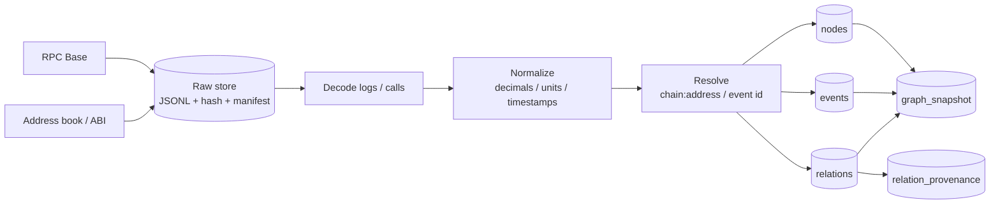

# 30_data — Sources on-chain et ingestion 72 h

**Auteur / agent** : Hermes-orchestrateur (deepseek-flash, session recherche V2).
**Date** : 2026-10-17.
**Chantier** : `30_data`.
**Statut** : INTERNE — recherche V2, ne pas soumettre.
**Périmètre** : sources, choix du premier slice, pipeline raw → normalisation → graphe, watermarks, reorg, qualité, quotas, plan 72 h.
**Fichiers lus** : `collect_corpus.py`, `src/orvyren/data/`, `src/orvyren/graph/store.py`, `B2_GRAPHE_ETUDE.md` §4, `10_graph__schema-cible__hermes__2026-10-17.md` §8, `10_graph__contradiction-72h-scope__codex__2026-10-17.md`, `10_graph__contradiction-sqlpgq-et-index__minimax-code__2026-10-17.md`.

---

## 0. Verdict

Il n'y a **pas de pipeline d'ingestion en inférence**. `collect_corpus.py` est un collecteur one-shot pour un cas ; il n'a ni scheduler, ni worker, ni watermark, ni source manifest. Les adaptateurs `src/orvyren/data/` existent mais ne sont pas câblés dans une boucle récurrente.

**Décision** : premier slice = **Aave v3 Base**, un marché, 30 jours, **10 000+ événements décodés**, un bloc finalisé, un portefeuille de démonstration. 50 000 seulement si le débit RPC est mesuré (Codex). **Pas de multi-chaîne, pas de 10⁵ promis, pas de GraphRAG.**

---

## 1. Sources

| Source | Fournit | Usage | Limites |
|---|---|---|---|
| RPC Base (`https://mainnet.base.org`) | `eth_getLogs`, `eth_call`, blocs | logs Aave, état, oracle | rate limit ; archive nécessaire pour vieux blocs |
| `aave/aave-address-book` | Pool, Oracle, aTokens, debt tokens | résolution des adresses | version à figer |
| Aave `IPool` ABI | décodage `Supply`, `Borrow`, `Repay`, `Withdraw`, `LiquidationCall`, `ReserveDataUpdated` | événements | ABI à figer |
| Aave Oracle / Chainlink | `latestRoundData`, `AnswerUpdated` | prix, heartbeat | feed et decimals à vérifier |
| DeFiLlama | prix/séries agrégées | source secondaire | ne pas confondre avec on-chain |
| The Graph / Ponder | backfill indexé | accélération | réponse attribuée, à rapprocher du RPC |
| Safe / Zodiac | rôles, allowances, modules | permissions agent | optionnel 72 h |
| Docs Aave/Chainlink | paramètres, incidents | preuve documentaire | extraction bornée |

**Familles de sources** : `onchain-base-aave` (primaire), `defillama` (secondaire), `docs` (documentaire). Ne jamais compter deux sources de la même famille comme deux preuves.

---

## 2. Périmètre 72 h

- **Chaîne** : Base mainnet, `chain_id = 8453`.
- **Protocole** : Aave v3.
- **Fenêtre** : 30 jours ; 90 si quotas.
- **Bloc** : finalisé ; snapshot unique.
- **Volume** : 10 000+ événements décodés, 2 000+ nœuds, 8 000+ relations.
- **Portefeuille** : adresse de démonstration avec positions Aave ; pas de clé privée, pas de fonds réels.
- **Mode** : `LIVE` ou `REPLAY` affiché ; si l'ingestion live échoue, basculer `REPLAY` explicitement, jamais faire passer une fixture pour du live.

---

## 3. Pipeline



### 3.1 Raw store

```
data/raw/<source_id>/<date>/<from_block>-<to_block>.jsonl.gz
```

Chaque ligne : `source_id`, `url`, `params`, `retrieved_at`, `block`, `body_hash`, `payload`. Le manifeste est immuable ; un run sans manifeste est invalide.

### 3.2 Décodage

- `eth_getLogs` par chunks de 2 000–10 000 blocs.
- `eth_call` sur bloc d'archive pour l'état (`getReserveData`, `getUserAccountData`, `latestRoundData`, `decimals`, `balanceOf`).
- Décoder avec ABI ; conserver `raw_log` + `decoded`.
- Un événement = `(chain_id, tx_hash, log_index)`.

### 3.3 Normalisation

- Montants : `raw_amount`, `amount`, `decimals`, `unit` ; jamais d'arrondi avant l'affichage.
- Adresses : lowercase pour la clé, checksum pour l'affichage.
- Temps : `block_time`, `retrieved_at`, `event_time` séparés.
- Qualité : fraîcheur, complétude, cohérence, duplication, schéma.

### 3.4 Écriture graphe

- `nodes` : adresses, assets, markets, oracles, rôles.
- `events` : logs décodés + événements documentaires.
- `relations` : 8–10 kinds core.
- `relation_provenance` : source/observation/event.
- `source_family_id` : indépendance.
- Idempotence : `INSERT OR IGNORE` / upsert contrôlé.

---

## 4. Watermark et reorg

```sql
CREATE TABLE ingestion_watermarks (
    source_id TEXT PRIMARY KEY,
    last_block INTEGER NOT NULL,
    last_block_hash TEXT,
    last_ts TEXT NOT NULL,
    status TEXT NOT NULL DEFAULT 'OK'
);
```

- Lire par chunks ; reprendre au watermark.
- `finalized` si disponible ; sinon profondeur 64 et `finality=PENDING`.
- Reorg : marquer `REORGED`, ne pas supprimer ; replay du segment.
- Un fait validé n'est jamais réécrit.

---

## 5. Qualité et quotas

| Contrôle | Règle |
|---|---|
| Fraîcheur | oracle/observation < heartbeat |
| Complétude | marchés attendus vs observés |
| Cohérence | supply on-chain vs DeFiLlama |
| Duplication | hash de contenu |
| Indépendance | `source_family_id` distinct |
| Schéma | ABI/version |
| Reorg | bloc/hash + finalité |

**Coût** : RPC public gratuit ; address book/ABI gratuits ; DeFiLlama gratuit ; pas de service payant pour le slice. Si le RPC public limite, utiliser un provider archive free et documenter le quota.

---

## 6. Plan 72 h

| Fenêtre | Livrable |
|---|---|
| H0–H4 | adresse book/ABI figés, RPC vérifié, bloc finalisé, wallet de démo |
| H4–H12 | raw store + manifest + watermark |
| H12–H24 | 10k événements décodés + nodes/events |
| H24–H36 | 8–10 relations + provenance |
| H36–H48 | Q1/Q4/Q6/Q7/Q8 SQL + parité |
| H48–H60 | UI/démo, mode LIVE/REPLAY |
| H60–H72 | benchmark, snapshot, limites |

**Coupe** : multi-chaîne, bridges, extraction large, 10⁵, live reorg-safe.

---

## 7. Risques

| Risque | Mitigation |
|---|---|
| RPC rate-limited | provider archive free, cache, chunks |
| Adresses fausses | address book + `eth_call` de contrôle |
| Décodage faux | ABI + tests sur events connus |
| Volume trop élevé | 30 jours, 3–5 marchés |
| Reorg | finalité + `REORGED` |
| Fixture présentée comme live | libellé LIVE/REPLAY obligatoire |
| Scope 10⁵ | 10k d'abord, 50k si mesuré |

---

## 8. Sources

- `collect_corpus.py` ; `src/orvyren/data/` ; `src/orvyren/graph/store.py`.
- `B2_GRAPHE_ETUDE.md` §4.
- `10_graph__schema-cible__hermes__2026-10-17.md` §8.
- `10_graph__contradiction-72h-scope__codex__2026-10-17.md`.
- Aave `IPool.sol` — https://github.com/aave/aave-v3-core/blob/master/contracts/interfaces/IPool.sol — consulté 2026-10-17.
- Aave address book — https://github.com/aave/aave-address-book — consulté 2026-10-17.
- Base docs — https://docs.base.org/ — consulté 2026-10-17.
- Chainlink data feeds — https://docs.chain.link/data-feeds — consulté 2026-10-17.
- The Graph — https://thegraph.com/docs/en/subgraphs/querying/introduction/ — consulté 2026-10-17.
- Ponder — https://ponder.sh/docs/get-started — consulté 2026-10-17.
- DeFiLlama API — https://api-docs.defillama.com/ — consulté 2026-10-17.
