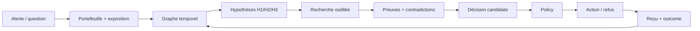

# 40_product — Persona, JTBD, UI et parcours

**Auteur / agent** : Hermes-orchestrateur (deepseek-flash, session recherche V2).
**Date** : 2026-10-17.
**Chantier** : `40_product`.
**Statut** : INTERNE — recherche V2, ne pas soumettre.
**Périmètre** : persona, problème, jobs-to-be-done, parcours, écran d'enquête, démo, métriques produit. Les documents d'idée V0.1/V0.2 et la sélection de cas sont la source.
**Fichiers lus** : `orvyren_v0_1_texte.txt` §3, `ORVYREN_Selection_Cas_Usage_V0_1.txt`, `ORVYREN_Document_de_reference_V0_2.txt` §3, `ORVYREN_DOC1_EXPLICATION_SIMPLE.md`, `src/orvyren/ui/screens.py`, `DEMO_KIT.md`, `10_graph__schema-cible__hermes__2026-10-17.md`.

---

## 0. Verdict

Le persona existait dans le V0.1 : **opérateur d'une petite trésorerie on-chain de DAO/protocole**. Il a été remplacé par un cas (`usdc-2023-03`) et par 12 écrans d'audit. Le produit n'a ni parcours récurrent ni espace de travail.

**Décision** : un **espace d'enquête unique** pour l'opérateur, pas 12 écrans. Le graphe, les preuves, la recherche, la décision, la policy et le reçu doivent être visibles dans un seul parcours. Le cas USDC devient une **fixture de régression**, pas le produit.

---

## 1. Persona

**Qui** : opérateur de trésorerie on-chain d'une DAO/protocole (ou analyste de risque DeFi), responsable d'une exposition en stablecoins/collatéraux, avec une policy écrite et un wallet borné.

**Contexte** : plusieurs marchés, plusieurs oracles, des positions collatéralisées, des permissions Zodiac/Safe, des données dispersées (RPC, docs, prix, gouvernance).

**Douleur** : il doit relier des signaux dispersés, distinguer une anomalie locale d'une contagion, trouver les preuves, décider d'agir ou de s'abstenir, et justifier la décision à un tiers.

**Ce qu'il ne veut pas** : un chatbot qui donne un prix sans source ; un agent qui signe sans policy ; un dashboard de 12 écrans.

---

## 2. Jobs-to-be-done

1. **Voir** l'exposition directe et indirecte à un bloc donné.
2. **Comprendre** ce qui menace cette exposition (collatéral, oracle, pont, gouvernance, permission).
3. **Conserver** plusieurs hypothèses concurrentes et savoir ce qui les départage.
4. **Chercher** le fait manquant avec des outils (RPC, logs, prix, documents).
5. **Décider** : action bornée, attente, `NO_ACTION`, escalade.
6. **Prouver** : source, timestamp, hash, chemin de décision.
7. **Agir** dans l'enveloppe, avec policy et reçu.
8. **Apprendre** : comparer le prévu au réalisé.

---

## 3. Parcours

**Écran unique** :

- **En-tête** : question, portefeuille, exposition, mode `LIVE/REPLAY/SYNTHETIC`, bloc/hash, âge des données.
- **Colonne gauche** : hypothèses, critères de réfutation, branches.
- **Centre** : graphe temporel, chemins, preuves, contradictions, inconnues.
- **Droite** : recherche en cours (outils, coûts, observations), décision, policy, action, reçu.
- **Pied** : trace, provenance, hash, limites.

**Cinq interactions clés** :

1. Cliquer un actif → voir les chemins d'exposition.
2. Cliquer une hypothèse → voir les preuves pour/contre et le fait manquant.
3. Lancer une recherche → voir l'outil, l'observation, le coût.
4. Comparer deux snapshots → voir ce qui a changé.
5. Ouvrir la policy → voir pourquoi ALLOW/DENY/REQUIRE_APPROVAL.

---

## 4. Démo 5 minutes

1. **Alerte** : un marché Aave dépasse un seuil de concentration / un oracle est stale.
2. **Graphe** : Q1 exposition, Q7 concentration, Q8 permissions.
3. **Hypothèses** : H1 local, H2 contagion, H3 oracle stale.
4. **Recherche** : `chain_logs`, `price_history`, `graph_missing`.
5. **Décision** : `ACTION_RECOMMENDED` / `NO_ACTION` / `REQUIRE_APPROVAL`.
6. **Policy** : ALLOW/DENY/REQUIRE_APPROVAL.
7. **Action** : tx testnet ou refus ; reçu ; mise à jour du graphe.
8. **Preuve** : Q6 provenance, snapshot, T10.

**Règle** : le graphe doit être visible dans les 30 premières secondes. Le jury doit voir un système, pas une collection d'écrans.

---

## 5. Métriques produit

- temps jusqu'à la première preuve ;
- temps jusqu'à la décision ;
- % de claims sourcés ;
- nombre d'inconnues détectées ;
- faux signaux / faux `NO_ACTION` ;
- coût par décision ;
- actions hors policy (doit être 0) ;
- confiance de l'opérateur (qualitatif).

---

## 6. Plan 72 h

- Un écran d'enquête, pas 12.
- Brancher Q1/Q4/Q6/Q7/Q8 + 3 outils.
- Une démo 5 min avec un cas Aave et un snapshot.
- **Pas** de design system, pas de multi-page, pas de compte utilisateur.
- **Pas** de captures d'écran avant que le système tourne.

---

## 7. Risques

| Risque | Mitigation |
|---|---|
| Refaire 12 écrans | un seul parcours |
| Démo sans données | snapshot + mode REPLAY explicite |
| Persona vague | opérateur de trésorerie, pas « DeFi user » |
| Graph décoratif | Q1/Q7/Q8 au centre |
| Action non prouvée | policy + reçu |
| Scope UI | 5 interactions |

---

## 8. Sources

- `orvyren_v0_1_texte.txt` §3 (persona, problème, JTBD).
- `ORVYREN_Selection_Cas_Usage_V0_1.txt` §4–7.
- `ORVYREN_Document_de_reference_V0_2.txt` §3.
- `ORVYREN_DOC1_EXPLICATION_SIMPLE.md`.
- `src/orvyren/ui/screens.py` (12 écrans d'audit).
- `DEMO_KIT.md`.
- `10_graph__schema-cible__hermes__2026-10-17.md`.
