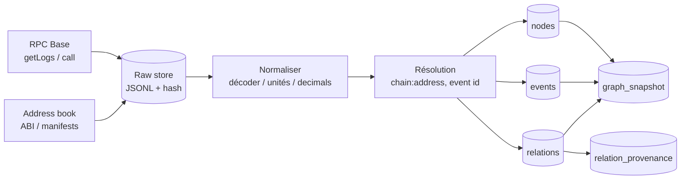

# Schéma cible du graphe ORVYREN

**Statut** : INTERNE — recherche V2, ne pas soumettre.
**Auteur** : Hermes.
**Date** : 2026-10-17.
**Chantier** : `10_graph`.
**Fichiers lus** : `src/orvyren/graph/catalog.py`, `record.py`, `queries.py`, `store.py`, `models.py`, `fixtures/graphs/*.json`, `evidence/graph.sqlite`, `evidence/quality_report.json`, `B2_GRAPHE_ETUDE.md` §0–7, `MIMIR_Technical_Design.md` §10–11, `Project_2_DFKG_Research_State_0_a11y.docx` §7–18, `MIMIR_Project_Description_V3.docx` §5–6, `bench_graph_scale.py` + `bench_results_guarded.json`.
**Mesures** : benchmark synthétique exécuté le 2026-10-17 dans `10_graph/_bench/` ; chiffres reproductibles, mais **pas** des données Aave réelles.

---

## 0. Verdict

Le graphe cible doit être **matérialisé, temporel, typé et requêtable**, pas une liste de `RelationRecord` en mémoire.

**Décision recommandée** :

1. **SQLite pour la démo 72 h** (zéro ops, fichier, `WITH RECURSIVE`, JSON1), **PostgreSQL + `WITHOUT OVERLAPS` (PG 19) comme cible** (Neon free, index, JSONB, contraintes temporelles natives). **Pas de SQL/PGQ** : le patch a été reverté ; PG 19 RC1 ne le livre pas (contradiction MiniMax, vérifiée sur les commits PostgreSQL).
2. **Pas de base graphe dédiée** pour le concours : Neo4j/Kuzu ajoutent une seconde base à synchroniser, alors que le goulot est le schéma et les données, pas le moteur (B2 §2.3).
3. **Un nœud `EVENT` de première classe**, une table `nodes`, une table `events`, une table `relations` qui persiste les **17 champs** + les champs on-chain, et une table `relation_provenance`.
4. **PIT bitemporel** : `valid_from/valid_to` pour le monde, `inserted_at/revision` pour la connaissance, `block_number` pour l'on-chain.
5. **16–18 relations peuplées** en 72 h, pas 34 ; le catalogue reste la vision, le graphe live doit être petit mais réel.

**Le point dur** : le schéma actuel ne peut pas stocker le record 17 champs. `store.py:94–104` n'a que 7 champs métier (`relation_id`, `revision`, `src`, `dst`, `kind`, `source_family_id`, `extract_method`) + `inserted_at`. Tant que ce n'est pas corrigé, le graphe ne peut pas distinguer un fait d'une hypothèse, une relation active d'une relation rejetée, ou un fait valide au bloc B d'un fait connu plus tard.

---

## 1. Ce qui existe, ce qui manque

| Élément | État | Preuve |
|---|---|---|
| Catalogue 34 relations | **existe** | `catalog.py:272–408` ; 8/15/3/8 ; 14 M / 13 D / 7 N |
| Record 17 champs | **spécifié** | `record.py:86–135`, groupes `:138–156` |
| Validation de conformité | **existe** | `record.py:226+` ; `validate_relation_record` |
| Q1–Q8 | **existent, sur fixtures** | `queries.py:10–27`, fonctions pures sur `Sequence[RelationRecord]` |
| Store SQLite append-only | **existe, schéma mince** | `store.py:52–134` ; `relations` à 7 champs métier |
| Tables `nodes` / `events` | **absentes** | `sqlite3` sur `evidence/graph.sqlite` |
| Graphe live | **520 observations, 4 claims, 4 relations `SUPPORTS`** | `evidence/graph.sqlite` |
| Fixtures | **20 records, 13 kinds** | `fixtures/graphs/*.json` |
| Pipeline d'ingestion | **one-shot** | `collect_corpus.py` ; pas de scheduler/worker |
| Requêtes SQL | **absentes** | Q1–Q8 sont du Python sur fixtures |

**Conséquence** : le schéma cible n'est pas une optimisation ; c'est la condition pour que le graphe existe.

---

## 2. Décision de stockage

### 2.1 Options

| Option | Avantages | Limites | Verdict |
|---|---|---|---|
| **SQLite** | zéro ops, fichier, démo offline, `WITH RECURSIVE`, JSON1, tests rapides | écriture mono-writer, pas de SQL/PGQ, moins bon pour concurrence | **Démo 72 h** |
| **PostgreSQL + `WITHOUT OVERLAPS`** | index, JSONB, transactions, contraintes temporelles natives (PG 19), `pgvector` optionnel, Neon free | service à opérer, scale-to-zero, quota ; **SQL/PGQ non livrable** | **Cible** |
| **Neo4j AuraDB Free** | Cypher, algos, visualisation | 200k nœuds/400k relations, 2ᵉ base à synchroniser, hors trajectoire | **Non** |
| **Kuzu** | embarqué, rapide | projet archivé le 10/10/2025, support nul (B2 §2.3) | **Non** |
| **DuckDB/Parquet** | analytique, scans, walk-forward | pas un store transactionnel de faits | **Companion analytique** |
| **XTDB** | bitemporel natif | jeune, service à opérer | **Non pour le concours** |

### 2.2 Règle

- **Un seul `GraphStore` interface**, deux dialectes : SQLite (démo) et PostgreSQL (cible).
- Le DDL est écrit pour PostgreSQL, puis adapté en SQLite (types `TEXT`, `REAL`, `INTEGER`, JSON1).
- Les requêtes Q1–Q14 sont écrites en SQL standard + `WITH RECURSIVE` ; **SQL/PGQ n'est pas une dépendance** (patch reverté, aucune version livrable) ; `WITHOUT OVERLAPS` (PG 19) est la seule capacité temporelle native à retenir.
- **Pas de base graphe** avant d'avoir mesuré que Postgres ne suffit pas.

---

## 3. Modèle de nœuds

### 3.1 Classes et kinds

Le catalogue utilise 9 classes (B2 §3.0) : `ORGANISATION`, `ACTIF`, `CONTRAT`, `ADRESSE`, `CHAINE`, `UNITE`, `PREUVE`, `DECISION`, `GOUVERNANCE`. Il faut ajouter une 10e classe : **`EVENEMENT`**, avec le kind concret `EVENT`.

Kinds concrets à ajouter ou à rendre explicites :

- `EVENT` (classe `EVENEMENT`) : un log décodé, un communiqué, une gouvernance, un gel.
- `PARAMETRE` (classe `CONTRAT` ou `GOUVERNANCE`) : `supplyCap`, `LTV`, `LT`, `oracle heartbeat`, `pause`.
- `POSITION` (classe `DECISION` ou `ACTIF`) : une position de prêt, avec collatéral/dette.
- `SOURCE`, `OBSERVATION`, `CLAIM`, `DOCUMENT`, `EXTRACTION_RUN` (classe `PREUVE`).
- `HYPOTHESIS`, `BRANCH`, `DECISION_NODE`, `INTENT`, `EXECUTION`, `OUTCOME` (classe `DECISION`).
- `ROLE`, `PERMISSION`, `TIMELOCK` (classe `GOUVERNANCE`).

Le catalogue actuel a déjà la plupart de ces kinds ; `EVENT` et `PARAMETRE` sont les ajouts structurants.

### 3.2 Identifiants canoniques

**Règle** : un ticker, un symbole ou un nom marketing n'est **jamais** une clé. Les alias sont des preuves rattachées.

| Objet | `node_id` | Exemple |
|---|---|---|
| Contrat / token / EOA | `addr:eip155:<chain_id>:<address_lower>` | `addr:eip155:8453:0x...` |
| Actif | `asset:eip155:<chain_id>:<address_lower>` | `asset:eip155:8453:0x...` |
| Marché / pool | `market:eip155:<chain_id>:<address_lower>` | `market:eip155:8453:0x...` |
| Organisation | `org:<slug>` | `org:circle` |
| Rôle | `role:eip155:<chain_id>:<modifier>:<role_key>` | `role:eip155:8453:0x...:AGENT` |
| Événement | `event:eip155:<chain_id>:<tx_hash>:<log_index>` | `event:eip155:8453:0x...:12` |
| Observation | `obs:<fingerprint>` | `obs:547c6426c72953ad` |
| Claim | `claim:<fingerprint>` | `claim:d6cb095fc695a249` |
| Hypothèse | `hyp:<uuid>` | `hyp:...` |
| Document | `doc:sha256:<hash>` | `doc:sha256:...` |
| Paramètre | `param:eip155:<chain_id>:<contract>:<name>` | `param:eip155:8453:0x...:supply_cap` |

**Adresses** : stocker la forme lowercase pour la clé, la forme checksum (EIP-55) pour l'affichage. Ne jamais fusionner deux adresses sur la base d'un symbole ; `SAME_AS` explicite, daté, avec preuve.

### 3.3 Table `nodes`

```sql
CREATE TABLE nodes (
    node_id        TEXT NOT NULL,
    revision       INTEGER NOT NULL DEFAULT 1,
    kind           TEXT NOT NULL,          -- STABLECOIN, MARCHE, EVENT, ROLE...
    class          TEXT NOT NULL,          -- ORGANISATION, ACTIF, ..., EVENEMENT
    chain_id       INTEGER,                -- NULL pour org/doc/claim
    address        TEXT,                   -- lowercase, NULL si non on-chain
    canonical_key  TEXT NOT NULL,          -- clé stable de déduplication
    label          TEXT NOT NULL,
    status         TEXT NOT NULL DEFAULT 'ACTIVE',
    valid_from     TIMESTAMPTZ,
    valid_to       TIMESTAMPTZ,
    inserted_at    TIMESTAMPTZ NOT NULL,
    payload        JSONB NOT NULL DEFAULT '{}',
    PRIMARY KEY (node_id, revision)
);

CREATE INDEX idx_nodes_kind        ON nodes(kind);
CREATE INDEX idx_nodes_class       ON nodes(class);
CREATE INDEX idx_nodes_chain_addr  ON nodes(chain_id, address);
CREATE INDEX idx_nodes_label       ON nodes(label);
```

**Alias** :

```sql
CREATE TABLE node_aliases (
    alias_id      TEXT PRIMARY KEY,
    node_id       TEXT NOT NULL,
    alias         TEXT NOT NULL,
    source_id     TEXT NOT NULL,
    valid_from    TIMESTAMPTZ,
    valid_to      TIMESTAMPTZ,
    confidence    REAL NOT NULL DEFAULT 0.0,
    inserted_at   TIMESTAMPTZ NOT NULL
);
CREATE UNIQUE INDEX idx_alias_current
    ON node_aliases(alias, source_id, COALESCE(valid_to, 'infinity'));
```

**Règle** : un alias sans source n'est pas une preuve ; il ne peut pas créer un nœud.

---

## 4. Modèle d'événements

Un **événement** est un objet du monde, pas un attribut. Il a un temps, des acteurs, des cibles, une magnitude, un statut et une provenance.

### 4.1 Table `events`

```sql
CREATE TABLE events (
    event_id          TEXT PRIMARY KEY,
    event_type        TEXT NOT NULL,       -- SUPPLY, BORROW, FREEZE, UPGRADE...
    chain_id          INTEGER,
    block_number      BIGINT,
    block_hash        TEXT,
    tx_hash           TEXT,
    log_index         INTEGER,
    event_time        TIMESTAMPTZ,         -- quand le fait s'est produit
    publication_time  TIMESTAMPTZ,         -- quand il est devenu public
    observation_time  TIMESTAMPTZ NOT NULL,-- quand le système l'a vu
    effective_time    TIMESTAMPTZ,         -- quand l'effet s'applique
    valid_from        TIMESTAMPTZ,
    valid_to          TIMESTAMPTZ,
    actors            JSONB NOT NULL DEFAULT '[]',
    targets           JSONB NOT NULL DEFAULT '[]',
    magnitude         NUMERIC,
    actual            NUMERIC,
    expected          NUMERIC,
    surprise          NUMERIC,
    status            TEXT NOT NULL,       -- RUMOR/ANNOUNCED/CONFIRMED/IMPLEMENTED/CONSEQUENCE
    payload           JSONB NOT NULL DEFAULT '{}',
    UNIQUE (chain_id, tx_hash, log_index)
);

CREATE INDEX idx_events_type_time ON events(event_type, event_time);
CREATE INDEX idx_events_chain_block ON events(chain_id, block_number);
CREATE INDEX idx_events_tx ON events(chain_id, tx_hash);
```

### 4.2 `event_observations`

Un événement peut être observé par plusieurs sources : log brut, document, prix, gouvernance.

```sql
CREATE TABLE event_observations (
    event_id       TEXT NOT NULL,
    observation_id TEXT NOT NULL,
    relation       TEXT NOT NULL,   -- SUPPORTS / CONTRADICTS / DERIVED_FROM
    source_id      TEXT NOT NULL,
    confidence     REAL NOT NULL DEFAULT 0.0,
    inserted_at    TIMESTAMPTZ NOT NULL,
    PRIMARY KEY (event_id, observation_id, relation)
);
```

### 4.3 Types d'événements pour Aave v3

**Pool** : `Supply`, `Withdraw`, `Borrow`, `Repay`, `LiquidationCall`, `FlashLoan`, `ReserveDataUpdated`, `ReserveUsedAsCollateralEnabled`, `ReserveUsedAsCollateralDisabled`, `MintedToTreasury`.
**Oracle** : `AnswerUpdated`, `NewRound`.
**Tokens** : `Transfer`, `Approval`, `Mint`, `Burn`.
**Proxy** : `Upgraded`, `AdminChanged`, `BeaconUpgraded`.
**Safe** : `ExecutionSuccess`, `ExecutionFailure`, `EnabledModule`, `DisabledModule`, `ChangedThreshold`, `AddedOwner`, `RemovedOwner`, `ChangedGuard`.
**Zodiac Roles** : `AssignRoles`, `SetDefaultRole`, `RolesModSetup`, `ConsumeAllowance`.
**Gouvernance** (si périmètre) : `ProposalCreated`, `VoteCast`, `ProposalExecuted`.

### 4.4 Granularité

- Un **log décodé qui change l'état** = un événement (`Supply`, `Borrow`, `Freeze`, `Upgrade`, `AssignRoles`).
- Un **tick de prix** = une observation, pas un événement.
- Un **transfert ERC-20** = un événement, mais il n'est pas forcément une relation ; on ne crée pas une arête par transfert. On agrège pour l'UI et on ne matérialise que les transferts qui changent une position ou une permission.
- Un **document** peut décrire plusieurs événements ; un événement peut être décrit par plusieurs documents. La résolution d'événements est explicite (`event_observations`), pas une fusion silencieuse.

**Provenance** : `Source → Observation → Event → Claim/Relation → Hypothesis → Decision → Execution → Outcome`. Event s'insère entre Observation et Claim/Relation ; c'est un ajout par rapport à la chaîne MIMIR, justifié par le on-chain.

---

## 5. Record de relation : 17 champs + extensions on-chain

### 5.1 Les 17 champs

Le record de `record.py` est bon ; il doit devenir le schéma SQL, pas seulement une dataclass.

| # | Champ | SQL | Note |
|---:|---|---|---|
| 1 | `relation_id` | `TEXT` | ULID stable |
| 2 | `family` | `TEXT` | 4 familles |
| 3 | `kind` | `TEXT` | 34 kinds |
| 4 | `src`, `dst`, `src_kind`, `dst_kind` | `TEXT` | références typées |
| 5 | `mechanism` | `TEXT` | label court |
| 6 | `sign_prior` | `TEXT` | `+`, `-`, `ambigu` |
| 7 | `conditions`, `regime_scope`, `horizon_scope` | `TEXT` | prédicats + portée |
| 8 | `epistemic_status` | `TEXT` | FACT/REPORTED/STATISTICAL/CAUSAL-DOCUMENTED/CAUSAL-HYPOTHESIS/MODEL-INFERRED/REJECTED |
| 9 | `lifecycle` | `TEXT` | DISCOVERED → ... → REJECTED |
| 10 | `validation_status` | `TEXT` | PENDING/VALIDATED/QUARANTINED/REJECTED |
| 11 | `valid_from`, `valid_to` | `TIMESTAMPTZ` | monde |
| 12 | `revision`, `inserted_at`, `superseded_by` | `INTEGER`, `TIMESTAMPTZ`, `TEXT` | connaissance |
| 13 | `provenance_refs`, `source_family_id` | table de liens | preuve + indépendance |
| 14 | `extract_method`, `model_version`, `run_id` | `TEXT` | audit d'extraction |
| 15 | `chain_ref` | `chain_id`, `block_number`, `tx_hash`, `log_index` | ancre on-chain |
| 16 | `confidence` | `REAL` | [0,1], méthode documentée |
| 17 | `payload` | `JSONB` | champs famille |

### 5.2 Extensions on-chain

Ajouter :

- `valid_from_block`, `valid_to_block` (`BIGINT`) pour les familles 2 et 4 : un fait on-chain est vrai par bloc, pas seulement par timestamp.
- `block_hash` (finalité/reorg), `finality` (`PENDING`/`SAFE`/`FINALIZED`).
- `quantity`, `unit`, `decimals` dans `payload` ; une quantité sans unité est invalide (règle B2 §3.0).
- `grant_proof` pour `AUTHORIZES`, `REVOKES`, `MEMBER_OF`, `ALLOWS` (event/ref).
- `implementation` pour `IMPLEMENTED_BY` (proxy → implémentation).

### 5.3 DDL `relations`

```sql
CREATE TABLE relations (
    relation_id       TEXT NOT NULL,
    revision          INTEGER NOT NULL DEFAULT 1,
    family            TEXT NOT NULL,
    kind              TEXT NOT NULL,
    src               TEXT NOT NULL,
    dst               TEXT NOT NULL,
    src_kind          TEXT NOT NULL,
    dst_kind          TEXT NOT NULL,
    mechanism         TEXT NOT NULL DEFAULT '',
    sign_prior        TEXT NOT NULL DEFAULT 'ambigu',
    conditions        TEXT NOT NULL DEFAULT '',
    regime_scope      TEXT NOT NULL DEFAULT '',
    horizon_scope     TEXT NOT NULL DEFAULT '',
    epistemic_status  TEXT NOT NULL,
    lifecycle         TEXT NOT NULL,
    validation_status TEXT NOT NULL,
    valid_from        TIMESTAMPTZ,
    valid_to          TIMESTAMPTZ,
    valid_from_block  BIGINT,
    valid_to_block    BIGINT,
    inserted_at       TIMESTAMPTZ NOT NULL,
    superseded_by     TEXT,
    source_family_id  TEXT NOT NULL,
    extract_method    TEXT NOT NULL,
    model_version     TEXT NOT NULL DEFAULT '',
    run_id            TEXT NOT NULL DEFAULT '',
    chain_id          INTEGER,
    block_number      BIGINT,
    block_hash        TEXT,
    tx_hash           TEXT,
    log_index         INTEGER,
    finality          TEXT NOT NULL DEFAULT 'FINALIZED',
    confidence        REAL NOT NULL DEFAULT 0.0,
    payload           JSONB NOT NULL DEFAULT '{}',
    PRIMARY KEY (relation_id, revision)
);

-- Ne pas créer d'index manuel sur (src, kind) / (dst, kind) sur l'append-only :
-- MiniMax a mesuré ×117–139 à 50k/100k (SQLite), car l'index manuel empêche
-- l'index automatique (lifecycle, src). La cible est une table `edge_current`
-- matérialisée, indexée sur (src, kind) si les mesures le justifient.
CREATE INDEX idx_rel_kind       ON relations(kind);
CREATE INDEX idx_rel_current    ON relations(relation_id, inserted_at);
CREATE INDEX idx_rel_valid      ON relations(valid_from, valid_to);
CREATE INDEX idx_rel_block      ON relations(chain_id, block_number);
CREATE INDEX idx_rel_active     ON relations(kind, lifecycle, validation_status)
    WHERE lifecycle = 'ACTIVE' AND validation_status = 'VALIDATED';
```

**Provenance** :

```sql
CREATE TABLE relation_provenance (
    relation_id      TEXT NOT NULL,
    revision         INTEGER NOT NULL,
    ref_id           TEXT NOT NULL,
    ref_kind         TEXT NOT NULL,  -- OBSERVATION/DOCUMENT/CLAIM/EVENT
    source_family_id TEXT NOT NULL,
    extract_method   TEXT NOT NULL,
    run_id           TEXT NOT NULL DEFAULT '',
    PRIMARY KEY (relation_id, revision, ref_id)
);

CREATE TABLE source_families (
    source_family_id TEXT PRIMARY KEY,
    description      TEXT NOT NULL,
    independence     TEXT NOT NULL   -- PRIMARY / SECONDARY / DERIVED / SAME_ARCHIVE
);
```

`source_family_id` est la clé de l'indépendance : deux sources du même famille ne comptent pas comme deux preuves (B2 §4.3, INV-DEPENDENCE).

---

## 6. Temporalité et PIT

### 6.1 Six horloges

| Horloge | Champ | Usage |
|---|---|---|
| event time | `event_time` / `valid_from` | quand le fait se produit |
| publication time | `publication_time` | quand il devient public |
| observation time | `observation_time` / `retrieved_at` | quand le système le voit |
| effective time | `effective_time` | quand l'effet s'applique |
| validity | `valid_from` / `valid_to` | intervalle où le fait est vrai |
| revision | `inserted_at` / `revision` | quand la connaissance change |

### 6.2 Deux lectures

- **Le monde à T** : `valid_from <= T AND (valid_to IS NULL OR T < valid_to)`.
- **Ce que le système savait à T** : `inserted_at <= T`, révision maximale par `relation_id`.
- **PIT state** : intersection des deux. C'est ce que la décision doit utiliser.

```sql
WITH known AS (
    SELECT relation_id, MAX(revision) AS rev
    FROM relations
    WHERE inserted_at <= $as_of
    GROUP BY relation_id
)
SELECT r.*
FROM relations r
JOIN known k ON k.relation_id = r.relation_id AND k.rev = r.revision
WHERE r.valid_from <= $as_of
  AND (r.valid_to IS NULL OR $as_of < r.valid_to);
```

**On-chain** : utiliser `block_number` comme temps primaire. `as_of_block` filtre `block_number <= B` et `valid_from_block <= B < valid_to_block` ; le timestamp n'est qu'un affichage.

### 6.3 Snapshots

`graph_snapshots(snapshot_id, as_of, as_of_block, graph_hash, counts, created_at)` ; une décision référence un snapshot, ne le copie pas. Le hash est calculé sur les lignes courantes + compteurs, comme `store.snapshot()` aujourd'hui.

---

## 7. Requêtes Q1–Q14

### 7.1 Mapping

| # | Requête | Pattern | Index |
|---|---|---|---|
| Q1 | Exposition consolidée | `HOLDS` puis `DEPOSITED_IN`/`COLLATERALIZES`/`REHYPOTHECATED_TO`, profondeur ≤3, pas de HOLDS transitif | `(src,kind)`, `(dst,kind)` |
| Q2 | Chemins de dépendance | `DEPENDS_ON`/`AFFECTS`, profondeur ≤3, décroissance, pas de `SUPPORTS`/`CONTRADICTS`/`CORRELATES_WITH` | `(src,kind)`, `(dst,kind)` |
| Q3 | Contradictions ouvertes | `CONTRADICTS` + statut | `(kind,lifecycle)` |
| Q4 | État PIT | `known_at` ∩ `world_at` | `(relation_id,inserted_at)`, `(valid_from,valid_to)` |
| Q5 | Chronologie | `events` + `relations` entre T1/T2 | `events(event_time)`, `relations(valid_from)` |
| Q6 | Provenance | `relation_provenance` → claims → observations → sources | PK + `ref_id` |
| Q7 | Concentration | `OWES`/`COLLATERALIZES` + agrégats | `(kind,src)`, `(kind,dst)` |
| Q8 | Permissions | `MEMBER_OF`/`ALLOWS`/`REVOKES` as-of block | `(kind,block_number)` |
| Q9 | Fraîcheur | observations/oracles vs heartbeat | `observations(metric,ts_event)` |
| Q10 | Faits manquants | anti-join types attendus vs présents | `(kind,src)` |
| Q11 | Invariants inter-chaînes | `DEPLOYED_ON`/`BRIDGED_VIA` + agrégats | `(chain_id)`, `(kind)` |
| Q12 | Chaîne de contrôle | `ADMINISTERED_BY`/`GOVERNED_BY`/`IMPLEMENTED_BY` | `(src,kind)` |
| Q13 | Révision | `SUPERSEDES`/`valid_to` | `(relation_id,revision)` |
| Q14 | Recherche sémantique | `pgvector` (optionnel) | HNSW |

### 7.2 Q1 — exposition consolidée

```sql
WITH RECURSIVE direct(asset) AS (
    SELECT DISTINCT dst
    FROM relations
    WHERE src = $holder AND kind = 'HOLDS'
      AND lifecycle = 'ACTIVE' AND validation_status = 'VALIDATED'
      AND valid_from <= $as_of AND (valid_to IS NULL OR $as_of < valid_to)
),
walk(asset, protocol, kind, depth, trail) AS (
    SELECT asset, NULL, NULL, 0, '/' || asset || '/'
    FROM direct
    UNION
    SELECT w.asset, r.dst, r.kind, w.depth + 1, w.trail || r.dst || '/'
    FROM walk w
    JOIN relations r ON r.src = w.asset
    WHERE w.depth < 3
      AND r.kind IN ('DEPOSITED_IN','COLLATERALIZES','REHYPOTHECATED_TO')
      AND r.lifecycle = 'ACTIVE' AND r.validation_status = 'VALIDATED'
      AND r.valid_from <= $as_of AND (r.valid_to IS NULL OR $as_of < r.valid_to)
      AND instr(w.trail, '/' || r.dst || '/') = 0
)
SELECT * FROM walk;
```

**Invariant** : pas de clôture transitive de `HOLDS` (détenir ≠ contrôler) ; la profondeur est bornée ; les cycles sont détectés par `trail`. Le SQL ci-dessus est écrit pour SQLite (`instr`) ; en PostgreSQL, remplacer `instr(...) = 0` par `strpos(...) = 0`.

### 7.3 Q2 — dépendances

```sql
WITH RECURSIVE walk(node, path, depth) AS (
    SELECT src, '|' || src || '|' || dst || '|', 1
    FROM relations
    WHERE kind IN ('DEPENDS_ON','AFFECTS') AND dst = $asset
      AND lifecycle = 'ACTIVE' AND validation_status = 'VALIDATED'
    UNION ALL
    SELECT r.src, w.path || r.src || '|', w.depth + 1
    FROM walk w
    JOIN relations r ON r.dst = w.node
    WHERE r.kind IN ('DEPENDS_ON','AFFECTS')
      AND w.depth < 3
      AND instr(w.path, '|' || r.src || '|') = 0
)
SELECT * FROM walk;
```

**Interdit** : traverser `SUPPORTS`, `REFUTES`, `CONTRADICTS`, `CORRELATES_WITH` ; `CORRELATES_WITH` n'est jamais causal ; `AFFECTS` ne se propage que via le moteur de propagation déclaré, pas par une jointure libre.

### 7.4 Q8 — permissions as-of bloc

```sql
SELECT r.*
FROM relations r
WHERE r.kind IN ('MEMBER_OF','ALLOWS','REVOKES')
  AND r.chain_id = $chain
  AND r.block_number <= $block
  AND (r.valid_to_block IS NULL OR $block < r.valid_to_block)
  AND r.lifecycle = 'ACTIVE'
  AND r.validation_status = 'VALIDATED';
```

Pour `REVOKES`, la révocation ferme `valid_to_block` du droit correspondant ; on ne supprime pas la ligne.

### 7.5 Q10 — faits manquants

```sql
SELECT m.node_id AS market, $expected_kind AS missing_kind
FROM nodes m
WHERE m.kind = 'MARCHE'
  AND NOT EXISTS (
      SELECT 1 FROM relations r
      WHERE r.src = m.node_id AND r.kind = $expected_kind
  );
```

C'est la requête qui rend le graphe **utile à l'agent** : elle dit ce qui manque pour départager une hypothèse.

---

## 8. Pipeline d'ingestion 72 h : Aave v3 Base

### 8.1 Périmètre

- **Chaîne** : Base mainnet, `chain_id = 8453`.
- **Protocole** : Aave v3 (Pool, Oracle, aTokens, debt tokens).
- **Fenêtre** : **30 jours** d'abord ; extension à 90 jours si les quotas RPC le permettent.
- **Objectif** : **10 000+ événements décodés**, **2 000+ nœuds**, **8 000+ relations** ; 50 000 seulement si le débit RPC est mesuré (Codex conteste 10⁴–10⁵ en 72 h sans preuve).
- **Trésorerie** : une adresse de démonstration (EOA/Safe) avec des positions Aave ; pas de clé privée réelle, pas de fonds réels.

### 8.2 Sources

| Source | Usage | Remarque |
|---|---|---|
| RPC Base (`https://mainnet.base.org`) | `eth_getLogs`, `eth_call`, `eth_getBlockByNumber` | rate limits ; utiliser un provider archive free si besoin |
| `aave/aave-address-book` | adresses Pool, Oracle, aTokens, debt tokens | **ne pas hardcoder** ; résoudre par chaîne |
| Aave `IPool` ABI | décodage des events | `Supply`, `Withdraw`, `Borrow`, `Repay`, `LiquidationCall`, `ReserveDataUpdated` |
| Chainlink / Aave Oracle | prix on-chain, heartbeat | `latestRoundData`, `AnswerUpdated` |
| DeFiLlama | prix off-chain / séries | source **secondaire**, famille différente |
| Safe / Zodiac | permissions du wallet agent | optionnel 72 h, mais différenciant |

### 8.3 Flux



### 8.4 Manifeste de source

```json
{
  "source_id": "base-aave-v3-pool",
  "family_id": "onchain-base-aave",
  "chain_id": 8453,
  "endpoint": "https://mainnet.base.org",
  "contract": "0x...",
  "abi": "aave-v3-core/IPool.sol",
  "from_block": 0,
  "to_block": 0,
  "retrieved_at": "2026-10-17T00:00:00Z",
  "license": "public RPC",
  "limits": "rate-limited; chunk logs"
}
```

Le manifeste est stocké avec le hash du payload ; un run sans manifeste est invalide.

### 8.5 Normalisation

- Décoder les logs avec l'ABI ; conserver `raw_log` + `decoded`.
- Convertir les montants avec `decimals` ; stocker `raw_amount`, `amount`, `unit`.
- Résoudre `chain:address` → `node_id` ; créer les nœuds manquants avec `status=ACTIVE`.
- Un événement = `(chain_id, tx_hash, log_index)` ; idempotence `ON CONFLICT DO NOTHING`.
- Écrire les relations avec `source_family_id`, `extract_method=ONCHAIN_READ`, `chain_ref`.
- Écrire la provenance : `Source → Observation → Event → Relation`.

### 8.6 Watermark, reorg, finalité

```sql
CREATE TABLE ingestion_watermarks (
    source_id     TEXT PRIMARY KEY,
    last_block    BIGINT NOT NULL,
    last_block_hash TEXT,
    last_ts       TIMESTAMPTZ NOT NULL,
    status        TEXT NOT NULL DEFAULT 'OK'
);
```

- Lire par chunks de 2 000–10 000 blocs ; reprendre au watermark.
- Utiliser le tag `finalized` quand disponible ; sinon une profondeur de confirmation configurable (ex. 64 blocs) et `finality=PENDING`.
- Un fait orphelin par reorg est marqué `REORGED`, pas supprimé ; `superseded_by` pointe vers la réobservation.
- Ne jamais réécrire un fait validé ; append-only.

### 8.7 Qualité

- Fraîcheur : `now - observation_time` vs heartbeat.
- Complétude : marchés attendus vs marchés observés.
- Cohérence : supply on-chain vs DeFiLlama, prix oracle vs prix marché.
- Indépendance : `source_family_id` distinct pour les preuves secondaires.
- Un `quality_report` par run ; pas de décision sur une source stale.

---

## 9. Migration depuis le store actuel

### 9.1 Ajouts de colonnes

SQLite supporte `ALTER TABLE ADD COLUMN` ; les triggers append-only n'empêchent pas l'ajout de colonnes. Ajouter à `relations` :

```
family, src_kind, dst_kind, mechanism, sign_prior, conditions,
regime_scope, horizon_scope, epistemic_status, lifecycle,
validation_status, valid_from, valid_to, valid_from_block, valid_to_block,
superseded_by, source_family_id (existe), extract_method (existe),
model_version, run_id, chain_id, block_number, block_hash, tx_hash,
log_index, finality, confidence, payload
```

### 9.2 Backfill des 4 relations existantes

Les 4 `SUPPORTS` :

- `family = PROOF_DERIVATION`
- `src_kind = CLAIM`, `dst_kind = HYPOTHESE`
- `epistemic_status = REPORTED`
- `lifecycle = ACTIVE`
- `validation_status = VALIDATED`
- `provenance_refs` = refs du claim
- `source_family_id` = source des observations du claim
- `confidence` = qualité de la source
- `payload = {}`

### 9.3 Backfill des observations/claims

- 520 observations → `nodes(kind=OBSERVATION, class=PREUVE)` + `OBSERVED_FROM` vers `sources`.
- 4 claims → `nodes(kind=CLAIM, class=PREUVE)` + `DERIVED_FROM`/`EXTRACTED_FROM`.
- 1 hypothèse → `nodes(kind=HYPOTHESE, class=DECISION)`.
- Sources → `nodes(kind=SOURCE, class=PREUVE)`.

### 9.4 Code

- `GraphStore` gagne `insert_node`, `insert_event`, `insert_relation_record`, `as_of`, `snapshot`.
- `record.py` reste la validation ; `store.py` persiste tous les champs.
- `queries.py` reste le contrat de test sur fixtures ; ajouter `sql_queries.py` pour SQL.
- Test de **parité** : les mêmes fixtures, passées par `queries.py` et par SQL, doivent donner les mêmes résultats.
- Ancien `insert_relation` conservé pour compatibilité, mais marque `validation_status=PENDING` ; le nouveau writer exige un `RelationRecord`.

### 9.5 Tests

1. Migration vide → schéma cible.
2. Round-trip 17 champs.
3. Backfill 4 supports → 4 records valides.
4. PIT : un fait inséré après T n'apparaît pas à T.
5. Q1–Q8 parité fixture ↔ SQL.
6. Provenance : aucun claim sans observation, aucune relation sans source.
7. Idempotence : rejouer un batch ne duplique pas.
8. Reorg : un fait `REORGED` n'est plus retourné par `world_at`.
9. Snapshot stable : deux rebuilds donnent le même hash.

---

## 10. Benchmark mesuré

Benchmark synthétique `_bench/bench_graph_scale.py`, résultats `_bench/bench_results_guarded.json`. Topologie DeFi en grappe (hubs), 10 kinds, SQLite + `WITH RECURSIVE`.

| Relations | Nœuds | Validation | Q1 Python | Q1 SQLite | Q2 SQLite | Taille DB |
|---:|---:|---:|---:|---:|---:|---:|
| 1 000 | 179 | 4,96 ms | 4,51 ms | 17,69 ms | 0,31 ms | 356 Ko |
| 10 000 | 449 | 49,60 ms | 641,85 ms | 186,75 ms | 2,04 ms | 3,12 Mo |
| 50 000 | 1 649 | 277,16 ms | **20 703,95 ms** | **979,04 ms** | 31,21 ms | 15,66 Mo |

**Lecture** :

- La validation 17 champs coûte **0,28 s pour 50 000 relations** : elle n'est pas le goulot.
- Q1 en Python sur une `Sequence[RelationRecord]` coûte **20,7 s à 50 000** ; la même requête matérialisée en SQLite coûte **0,98 s** (≈21× plus rapide).
- Le chargement de 50 000 relations coûte **1,14 s** ; la base pèse **15,66 Mo**.
- Q2 synthétique a peu de chemins (1) ; son temps Python n'est pas représentatif. La requête SQL reste < 32 ms.

**Contradiction MiniMax (à intégrer)** : le générateur v2 ci-dessus est dégénéré (`q2_paths=1`, 60 arêtes/nœud). Le générateur v4 de MiniMax mesure **Q1 0,055 s à 50 000** et **0,220 s à 100 000** (×342 vs Python ; 31,7 Mo), et un index manuel `(src,kind)` coûte **×117–139**. La conclusion « SQL ≫ Python » tient, mais l'écart réel est ~16× supérieur à celui de ce tableau. Utiliser les chiffres v4 pour les seuils ; ce tableau reste un plancher conservateur.

**Limite** : topologie synthétique, pas Aave. Le vrai benchmark doit être refait sur 10k–50k événements Aave ; ces chiffres prouvent la **différence d'architecture** (matérialiser vs scanner Python), pas la performance finale.

**Critère d'acceptation provisoire** (après contradiction MiniMax) :

- 50 000 relations : Q1 SQL **< 0,25 s** (mesuré 0,055 s sur générateur v4) ; Q2 SQL < 100 ms.
- 100 000 relations : Q1 SQL **< 0,5 s** (mesuré 0,220 s sur v4) ; Q4/Q7/Q8 < 500 ms.
- Ne pas créer d'index manuel `(src, kind)` sur l'append-only ; matérialiser `edge_current` avant de l'indexer.
- 100 % des claims de décision ont une chaîne de provenance complète.
- 0 relation orpheline, 0 claim sans observation.

---

## 11. Plan 72 h

### 11.1 J1 — schéma + ingestion

- Créer `nodes`, `node_aliases`, `events`, `event_observations`, `relation_provenance`, `source_families`, `ingestion_watermarks`, `graph_snapshots`.
- Étendre `relations` aux 17 champs + champs on-chain.
- Résoudre les adresses Aave v3 Base via l'address book.
- Ingérer 30 jours de logs Pool/Oracle/tokens ; viser 10 000+ événements décodés.
- Backfill des 4 supports et des 520 observations.

### 11.2 J2 — relations + requêtes

- Peupler **8–10 relations** (Codex) : le chemin minimal `HOLDS → DEPOSITED_IN/COLLATERALIZES → PRICED_BY`, plus `OBSERVED_FROM`, `DERIVED_FROM`, `SUPPORTS`, `CONTRADICTS`, `CONSTRAINS`, `DEPLOYED_ON`. Les 16 relations précédentes sont un maximum conditionnel, pas un quota.
- Écrire Q1/Q4/Q6/Q7/Q8 en SQL ; test de parité fixture ↔ SQL.
- Brancher un outil agent `graph_query` sur les requêtes.
- UI : un panneau graphe + preuves + décision (un seul écran, pas 12).

### 11.3 J3 — preuve + démo

- Mesurer Q1/Q2/Q7/Q8 sur le graphe Aave ; publier p50/p95.
- Vérifier 100 % de provenance sur la décision de démo.
- Démo : alerte → requête graphe → hypothèse → recherche → décision → policy → action/refus → receipt.
- Tests, doc, snapshot hash ; fallback SQLite.

**Effort** : 40–50 h-agent, 2–3 agents. **Chemin critique** : ingestion Aave → relations structurelles → Q1 → décision. Les permissions peuvent être parallèles.

### 11.4 Ce qu'on coupe

- 34 relations peuplées → 16.
- Multi-chaîne → Base seule.
- Bridges/rehypothécation → schema-only.
- GNN/GraphRAG → non.
- Base graphe dédiée → non.
- Extraction documentaire large → 2–3 documents.
- UI complète → un écran d'enquête.
- EVAL N≥100 → non ; mesure honnête de la démo.

---

## 12. Ce qu'il ne faut pas construire

- **Pas de Neo4j/Kuzu** : le graphe tient dans Postgres/SQLite ; une seconde base ajoute un risque de synchronisation.
- **Pas de GNN/GraphRAG** dans le chemin de décision v1 : B2 §5.3 ; le graphe doit d'abord être peuplé et requêtable.
- **Pas de 34 relations peuplées** : 16 relations réelles valent mieux que 34 coquilles.
- **Pas de LLM pour produire un chiffre décisionnel** : les chiffres viennent des observations ; le LLM extrait des claims, jamais des prix.
- **Pas de swarm multi-agent** : un orchestrateur + un chercheur + un critique suffisent pour le MVP.
- **Pas de 12 écrans** : un espace d'enquête.
- **Pas de multi-chaîne** : Base seule pour la démo.

---

## 13. Risques et questions ouvertes

| Risque | Mitigation |
|---|---|
| RPC rate-limited / archive manquant | provider archive free, cache raw, chunk logs, 30 jours d'abord |
| Adresses Aave/proxies incorrectes | address book + `eth_call` de vérification, pas de hardcode |
| Volume d'events trop élevé | 30 jours, 3–5 marchés, agrégation des transfers |
| Décodage Aave faux | ABI officielle + tests sur 10 events connus + `eth_call` de contrôle |
| PIT/reorg | `finalized`, profondeur configurable, `REORGED` append-only |
| SQLite mono-writer | batch transactions, un seul writer, WAL |
| Scope creep | 16 relations, Base seule, un écran |
| Postgres free quota | SQLite pour la vidéo, Postgres en miroir ; Neon scale-to-zero |

**Questions ouvertes** :

1. Aave v3 Base ou Ethereum ? Base est moins chère et plus rapide ; Aave Base a moins de profondeur historique. Choisir Base pour le 72 h, Ethereum pour la crédibilité si le temps le permet.
2. 30 ou 90 jours ? 30 jours pour 10k+ events ; 90 si les quotas le permettent.
3. Quelle adresse de trésorerie ? Une adresse de démonstration avec des positions Aave, pas un vrai utilisateur.
4. Safe/Zodiac inclus ? Oui pour le différenciant agent wallet, mais seulement `MEMBER_OF`/`ALLOWS`/`ADMINISTERED_BY` ; pas tout le graphe de permissions.
5. Granularité des événements ? Un log = un event ; les transfers sont agrégés pour l'UI.
6. `IMPLEMENTED_BY` : 35e relation, P1 ; à ajouter au catalogue si le temps le permet.
7. Quantités : `payload.amount` + `unit` + `decimals` ; pas de double comptage.
8. PostgreSQL 19 `WITHOUT OVERLAPS` : à adopter pour l'intégrité temporelle si la GA est disponible ; **pas de SQL/PGQ** (patch reverté). SQLite `WITH RECURSIVE` reste la référence pour Q1–Q8.

---

## 14. Sources

### 14.1 Internes

- `D:/orvyren_core/src/orvyren/graph/catalog.py:272–408` — 34 relations ; `:414–419` — stats.
- `D:/orvyren_core/src/orvyren/graph/record.py:86–135` — record 17 champs ; `:138–156` — groupes.
- `D:/orvyren_core/src/orvyren/graph/queries.py:10–27` — Q1–Q8 ; `:89+`, `:134+`, `:198+`, `:215+`, `:224+`, `:251+`, `:288+`, `:336+`.
- `D:/orvyren_core/src/orvyren/graph/store.py:52–134` — schéma SQLite ; `:94–104` — table `relations`.
- `D:/orvyren_core/src/orvyren/graph/models.py:122–165` — `Source`, `Claim`, `Relation`.
- `D:/orvyren_core/fixtures/graphs/*.json` — 20 records, 13 kinds.
- `D:/orvyren_core/evidence/graph.sqlite` — 520 observations, 4 claims, 4 supports.
- `D:/orvyren_archive_2026-10-15/research/B2_GRAPHE_ETUDE.md` — §1–7.
- `D:/midas_v2/MIMIR/docs/MIMIR_Technical_Design.md` — §10.1–10.6, §11.2–11.4, §8.3.
- `C:/Users/User/Downloads/Project_2_DFKG_Research_State_0_a11y.docx` — §7–18.
- `D:/midas_v2/MIMIR/docs/MIMIR_Project_Description_V3.docx` — §5–6.
- `D:/orvyren_research_v2_2026-10-17/10_graph/_bench/bench_graph_scale.py` — benchmark.
- `D:/orvyren_research_v2_2026-10-17/10_graph/_bench/bench_results_guarded.json` — résultats.

### 14.2 Externes

- Aave, `IPool.sol` — https://github.com/aave/aave-v3-core/blob/master/contracts/interfaces/IPool.sol — consulté 2026-10-17.
- Aave, address book — https://github.com/aave/aave-address-book — consulté 2026-10-17.
- Aave, docs Pool — https://aave.com/docs/aave-v3/smart-contracts/pool — consulté 2026-10-17.
- Base, docs — https://docs.base.org/ — consulté 2026-10-17.
- EIP-1967, proxy storage slots — https://eips.ethereum.org/EIPS/eip-1967 — consulté 2026-10-17.
- Zodiac Roles — https://docs.roles.gnosisguild.org/ — consulté 2026-10-17.
- Safe docs — https://docs.safe.global/ — consulté 2026-10-17.
- PostgreSQL, documentation courante — https://www.postgresql.org/docs/current/index.html — consulté 2026-10-17.
- PostgreSQL 19, tables temporelles (`WITHOUT OVERLAPS`) — https://www.postgresql.org/docs/19/ddl-temporal-tables.html — consulté 2026-10-17.
- PostgreSQL, commit SQL/PGQ puis rollback — https://git.postgresql.org/gitweb/?p=postgresql.git;a=commit;h=2f094e7ac69 et https://git.postgresql.org/pg/commitdiff/2b9e1aff4d3d933ae8ee377fef22c2af9c7797e8 — consulté 2026-10-17.
- SQLite recursive CTE — https://sqlite.org/lang_with.html — consulté 2026-10-17.
- Neon pricing — https://neon.com/pricing — consulté 2026-10-17.
- The Graph, querying — https://thegraph.com/docs/en/subgraphs/querying/introduction/ — consulté 2026-10-17.
- Ponder — https://ponder.sh/docs/get-started — consulté 2026-10-17.
- DeFiLlama API — https://api-docs.defillama.com/ — consulté 2026-10-17.
